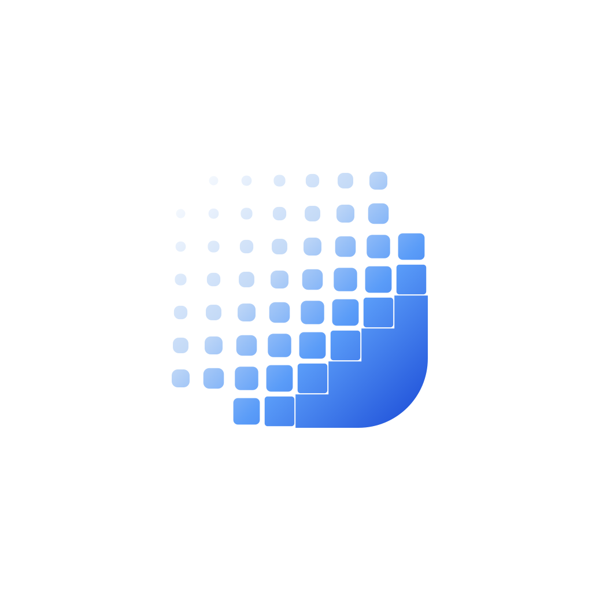
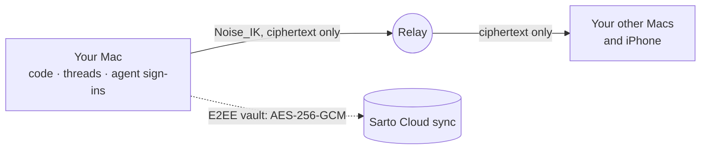

<div align="center">



<h1>Sarto</h1>

**The native macOS Agentic Development Environment (ADE) — run 46 coding agents in parallel and play a built-in idle RPG while you ship.**

_Sarto_ is Italian for _tailor_: a pure SwiftUI and Metal ADE that stitches every coding agent, Git worktree, terminal, browser and a pixel idle game into one private workspace — code while your agents grind.

[](#why-an-ade)
[](#native-to-the-mac)
[](#install)
[](#supported-agents)
[](#idle-rpg-grind-while-you-code)
[](./PRIVACY.md)
[](https://sarto.1o.ink/releases/latest)
[](./LICENSE)

[Download](https://sarto.1o.ink/releases/latest) · [Why an ADE](#why-an-ade) · [Idle RPG](#idle-rpg-grind-while-you-code) · [Supported Agents](#supported-agents) · [Security](./SECURITY.md) · [Privacy](./PRIVACY.md) · [简体中文](./README.zh-CN.md)

</div>

> [!NOTE]
> Sarto is in early, active development: v0.3.2 for macOS 15 or later on Apple silicon.

## Why an ADE

Traditional IDEs were built around typing one file at a time; terminal CLIs leave you juggling tabs without diffs, previews or approvals. **Sarto is an Agentic Development Environment (ADE)** — a native desktop workspace designed from the ground up for directing multiple AI coding agents at once, reviewing what they changed, and enjoying the wait while they work.

- **Pure native macOS, zero Electron.** Built with Swift 6, SwiftUI, AppKit and Metal with zero third-party Swift packages. Fast startup, MacBook notch Dynamic Island, menu bar quota tracking, and thermal- and battery-aware rendering.
- **Multi-agent orchestration in one GUI.** Run **Claude Code**, **OpenAI Codex**, **Gemini CLI**, **Cursor**, **GitHub Copilot**, **Google Antigravity**, **OpenCode**, **Cline**, **DeepSeek Harness**, **Pi** and 36 more **ACP (Agent Client Protocol)** agents side by side with your own CLI installs, API keys and subscriptions — across isolated Git worktrees or multiple Macs.
- **Code while you idle.** Waiting on a long agent run shouldn't mean staring at a spinner. Real coding turns and completed plan steps power a built-in pixel **Agent Idle RPG**: your agents fight through to-do lists, drop gear and level up in the side rail while they ship your code.
- **Local-first and end-to-end encrypted.** No telemetry, optional account, no server-side code storage, and `Noise_IK` + `AES-256-GCM` everywhere data leaves your Mac.

## Highlights

<table>
<tr>
<td width="33%" valign="top">

**Native macOS ADE**<br/>
SwiftUI, AppKit and Metal with zero Electron and zero third-party Swift packages. Menu bar, `⌘` shortcuts, Low Power Mode and thermal aware.

</td>
<td width="33%" valign="top">

**46 agents, one workspace**<br/>
Claude Code, Codex, Gemini CLI, Cursor, Copilot, Antigravity, OpenCode, Cline and 38 more — using your own installs and accounts.

</td>
<td width="33%" valign="top">

**Grind while you code**<br/>
A built-in pixel idle RPG where your agents battle through to-do lists, fire skills, earn loot and level up as they ship code. _In development._

</td>
</tr>
<tr>
<td valign="top">

**Beautiful**<br/>
Four Metal-lit optical palettes, matching runtime Dock icons, restrained motion and a Dynamic Island that grows out of the notch.

</td>
<td valign="top">

**Remote Claude Code**<br/>
Run Claude Code's model on another of your Macs while files, commands and permissions stay on this one.

</td>
<td valign="top">

**Tailored from the best**<br/>
Proven ideas from the tools developers already love, stitched into one consistent agentic workbench.

</td>
</tr>
</table>

## Private by design, verifiable by anyone

Sarto runs agents that read your code and run shell commands, so it is built so that **you never have to trust a server with your work**, and so that you can check every claim yourself.

- **Your work stays on your Macs.** Source code, project files, conversation history and your agents' own sign-ins never go to Sarto Cloud. Sarto has no telemetry and no analytics, and an account is optional.
- **End-to-end encrypted, everywhere it leaves.** Connections between your devices use `Noise_IK_25519_AESGCM_SHA256` through a relay that forwards only padded ciphertext. Settings, MCP secrets, skills, themes, memory and usage sync under a 256-bit key that never leaves your devices (`HKDF-SHA256`, `AES-256-GCM`). Push notifications are sealed to each phone's own key.
- **Open source, down to the wire.** The Mac app and the daemon are AGPL-3.0, and every protocol Sarto Cloud speaks is specified in the Apache-2.0 [`packages/sarto-wire`](./packages/sarto-wire/PROTOCOL.md).
- **Traceable builds.** Releases are built from public commits in [GitHub Actions](./.github/workflows/release-mac.yml), with SLSA build provenance attestations (from the first public release on) and `SHA256SUMS.txt`. Updates install only when they carry Sarto's Ed25519 signature and the same Apple code signature as the app you run.



[SECURITY.md](./SECURITY.md) and [PRIVACY.md](./PRIVACY.md) list every request Sarto makes, what the server can and cannot see, and the commands to verify a download.

## Multi-agent orchestration

- **6 native drivers and 40 ACP agents**: dedicated SDK, server and RPC drivers for **Claude Code**, **Codex**, **OpenCode**, **Pi**, **DeepSeek Harness** and **Cline** (OpenCode and Cline fall back to ACP), and the Agent Client Protocol for 40 more, including **Google Antigravity**, **Gemini CLI**, **Cursor**, **GitHub Copilot**, **Qwen Code** and **Kimi Code**. Sarto implements no agent: it drives your own installs, accounts and configurations.
- **Deep Antigravity support**: its context breakdown, per-request telemetry, plan mode, subagents, steering, question forms, plugins and plan limits.
- **Harness lifecycle**: checks prerequisites, guides installation and updates, and sets each agent's binary and start mode, plus the default permission mode for Claude Code, Codex, DeepSeek Harness and Antigravity.
- **Switch agents mid-session**: hand a session to another agent between turns with its context carried over, optionally summarized first.
- **Bring your history**: import sessions you started in Claude Code, Codex, Pi or any ACP agent that lists its sessions.
- **Plan quotas at a glance**: reads each signed-in agent's plan limits and balance from its vendor, and tracks tokens and spend from local logs at API list prices.

## Idle RPG: grind while you code

> [!NOTE]
> In development: the game, its balance and its art are still changing.

Agentic coding has natural pauses while models think, run test suites and execute multi-step plans. Sarto turns those background runs into a zero-distraction **Agent Idle RPG** tucked into the collapsible right rail — so you can **code and grind at the same time**:

- **Pixel Co-Op Todo Battles**: whenever a session has an active plan, Sarto and your coding agent team up in a pixel battle arena. Live coding turns fire attacks and auto-skills, and each completed plan step lands a finishing hit.
- **Per-agent RPG sheets and builds**: every agent grows its own RPG profile — rank tiers, power score (`PWR`), `DPS`, weapons, gear loadouts, medals and commander bond levels — fueled by real coding turns rather than mindless clicking.
- **Calm, battery-friendly motion**: four energy tiers step down from full **Arcade** combat (weapons, auto-skills and floating pixel damage popups) to **Calm**, **Still** or **Off**, automatically throttling for idle windows, Low Power Mode and thermal pressure.
- **Private while playing**: game progression uses only minimal opaque work facts (turn timing and step counts) — source code, prompts and file paths never leave your Mac.

## A workspace around the conversation

- **Composer**: a two-tier floating composer with agent and model pickers, pinned models, a model-accurate effort selector, permission modes, project and Git worktree pickers, `@` mentions of files, folders and sessions, `/` commands, images and attachments, `↑`/`↓` prompt history, and live popovers for the context window, prompt cache and output speed.
- **Flow control**: queue follow-ups or steer a running turn. Where the agent supports it, edit a sent message to rewind the conversation and its files, put it back if you change your mind, or fork a new session from any reply, with a warning when the prompt cache would expire.
- **Inline comments**: comment on passages of a reply and send them with your next message.
- **Session Board and subagents**: background commands, monitors and subagents with live progress, inline subagent cards and linked navigation.
- **Find anything**: `⌘K` searches every session on every connected Mac, `⌘F` finds within a session, and the outline popover, timeline rail and per-session reading position keep long threads navigable. Export any session as Markdown.
- **Git**: diffs against `HEAD` with per-file commit selection, branch and worktree-isolated sessions, AI-drafted commit messages and pull requests, and a next-step panel for conflicts, failed checks, reviews, publishing and merging on GitHub.
- **Files and terminals**: a project file tree with an editor that detects conflicting saves and restores drafts, and PTY terminals you can take over from an agent and hand back. Sarto pauses agent input when a terminal asks for a password.
- **Preview**: a built-in web browser agents can inspect and drive (and you can take over), iOS simulators, and Android emulators and devices, side by side.

## Native to the Mac

- **Dynamic Island**: a concave-shoulder island under the MacBook notch or atop any display, on one or several screens you pick on a display map. It shows live plan progress and lets you answer permissions, questions and plans from any of your Macs, with a stack of sessions, a usage tab and a nine-dot activity indicator.
- **Menu bar usage panel**: liquid quota tubes, plan rings, a live session banner, today's model ranking and 7, 30 and 90-day stacked usage charts across your agents and Macs. Closing the windows keeps Sarto and your agents running in the menu bar; `⌘Q` asks twice before closing the windows.
- **Signed self-updates**: Stable and Beta channels, binary delta patches, SHA-512 and code-signature checks, installed when you quit or step away. App-only updates keep the daemon and your running sessions alive.
- **Standalone daemon**: run Sarto's daemon on a headless Mac with the `sarto` CLI (`sarto login`, `status`, `update`, `logs`, `devices`, `terminal`, `service`).

## Beautiful

- **Prism visual system**: four optical palettes, `Obsidian Dark`, `Warm Charcoal`, `Daylight Crystal` and `Warm Alabaster`, drawn with Metal, each with a matching Dock icon that switches at runtime. Accent presets and an HSB color wheel, System, Dark or Light appearance, and adjustable thread text size, reading width and terminal font.
- **Calm by default**: motion tiers from Off to Ultra honor Reduce Motion, and every animated canvas lowers its frame rate for still views, Low Power Mode and thermal pressure.
- **A thread you can scan**: multi-step tool runs fold into one-line summaries on an expandable timeline rail, edits show as unified diff hunks, and permission, plan and question cards never fold away.
- **Rich replies**: syntax highlighting with folding for long code blocks, GFM tables, alerts, SVG and Mermaid diagrams (flowchart, sequence and state), and math.
- **Fully bilingual**: every screen in English and Simplified Chinese.

## Remote Claude Code

Start a Claude Code session on this Mac and let its **model run on another Mac of your account**, such as the one where Claude Code is signed in. Project files, shell commands, permissions and Sarto's tools stay on the Mac in front of you; only the model's turn runs remotely, over the same end-to-end encrypted channel.

- Off until the owner of the host Mac turns it on, with a limit on concurrent runs and idle processes reclaimed after a few minutes.
- Permission modes from "Ask before edits" to "Full access", and clear banners when the host Mac goes offline.

## Multi-Mac, and iPhone

- **One sidebar for all your Macs**: your Mac and the other trusted Macs of your account in one tree, with live connection states, cross-Mac search, island approvals, and remote files, Git and terminals. A Mac's terminal stays closed to other devices until you turn it on there.
- **End-to-end encrypted sync**: sign in with your browser to create a vault with a one-time 128-bit recovery key. A new Mac joins when you confirm the same 8-character code (`XXXX-XXXX`, commit-then-reveal) on a trusted Mac, or enter the recovery key.
- **Sarto for iPhone**: a native iOS companion app that adapts to iPhone Duo's foldable display, with encrypted push notifications and approvals on the go.

> [!NOTE]
> The iOS app's beta is complete and it is coming to the App Store soon. It is not part of this repository yet.

## Extensions and memory

- **MCP Hub**: browse registry servers or add your own, sign in with OAuth, and answer MCP elicitation forms inline. Secrets are encrypted with the macOS Keychain and sync only end-to-end encrypted.
- **Agent plugins**: manage plugins and marketplaces for Claude Code and Codex, and plugins for Antigravity.
- **Memory**: one memory across agents, global and per project. Agents propose global entries for you to approve, and you can edit, move and import entries, including Claude Code's own project memory.
- **Sarto's tools for agents**: agents can use Sarto's sessions, terminals, browser, devices, memory and settings through MCP.

## Tailored from the best

Sarto is a tailor's workshop: rather than reinvent what others did well, it takes the best ideas around and makes them fit together, natively.

| From                                                        | What Sarto took                                                          |
| ----------------------------------------------------------- | ------------------------------------------------------------------------ |
| [Kettu](https://github.com/KettuAI/Kettu)                   | The daemon and its hosts, which Sarto runs without Electron and extends  |
| [Cindy](https://github.com/makecindy/cindy)                 | The menu bar usage panel and the conversation timeline rail              |
| [Obsidian Prism](https://github.com/RMvdesi/obsidian-prism) | The palettes and the motion of the Prism visual system                   |
| [Code Island](https://github.com/wxtsky/CodeIsland)         | The Dynamic Island's silhouette                                          |
| 46 coding agents                                            | Each one driven in the way it works best, through its SDK, server or ACP |

[THIRD_PARTY_NOTICES.md](./THIRD_PARTY_NOTICES.md) has the full attributions and licenses.

## Install

### The Mac app

Download the latest release from [`sarto.1o.ink/releases/latest`](https://sarto.1o.ink/releases/latest) (`Sarto-<version>-arm64.dmg`) and drag Sarto to Applications. It needs macOS 15 or later on Apple silicon, and bundles its daemon and Node.js runtime.

### The standalone daemon

```sh
curl -fsSL https://sarto.1o.ink/releases/latest/download/install.sh | sh
```

It installs into `~/.local/share/sarto`, links `~/.local/bin/sarto` and registers a launchd user service (pipe to `sh -s -- --no-service` instead to skip it). Then run `sarto login`.

### From source

You need macOS 15 or later on Apple silicon, Xcode 16 or later, Node.js 22.13 or later and pnpm 10:

```sh
pnpm install
pnpm build:daemon
open apps/apple/Sarto.xcodeproj
```

Run the **SartoMac** scheme. [CONTRIBUTING.md](./CONTRIBUTING.md) covers development, tests and packaging.

## Supported agents

<details>
<summary><b>All 46 agents</b></summary>

|                                                                     |                                                                                     |                                                          |                                                                             |
| ------------------------------------------------------------------- | ----------------------------------------------------------------------------------- | -------------------------------------------------------- | --------------------------------------------------------------------------- |
| [Claude Code](https://github.com/anthropics/claude-code)            | [Codex](https://github.com/openai/codex)                                            | [OpenCode](https://opencode.ai)                          | [Pi](https://pi.dev)                                                        |
| [DeepSeek Harness](https://github.com/deepseek-ai/deepseek-harness) | [Cline](https://cline.bot/cli)                                                      | [Google Antigravity](https://antigravity.google)         | [Gemini CLI](https://github.com/google-gemini/gemini-cli)                   |
| [Cursor](https://cursor.com/docs/cli/acp)                           | [GitHub Copilot](https://github.com/github/copilot-cli)                             | [Qwen Code](https://github.com/QwenLM/qwen-code)         | [Kimi Code](https://github.com/MoonshotAI/kimi-code)                        |
| [Grok](https://x.ai/cli)                                            | [Amp](https://ampcode.com)                                                          | [goose](https://block.github.io/goose/)                  | [Kilo Code](https://kilo.ai)                                                |
| [Factory Droid](https://factory.ai/product/cli)                     | [OMP (Oh My Pi)](https://omp.sh)                                                    | [Hermes Agent](https://hermes-agent.nousresearch.com)    | [Devin](https://docs.devin.ai/cli)                                          |
| [Mistral Vibe](https://github.com/mistralai/mistral-vibe)           | [Junie](https://junie.jetbrains.com)                                                | [Auggie CLI](https://github.com/augmentcode/auggie)      | [VT Code](https://github.com/vinhnx/VTCode)                                 |
| [Qoder CLI](https://qoder.com)                                      | [Qoder CN](https://qoder.cn)                                                        | [Codebuddy Code](https://www.codebuddy.cn/cli/)          | [DeepAgents](https://docs.langchain.com/oss/javascript/deepagents/overview) |
| [DimCode](https://dimagent.cn/)                                     | [Dirac](https://dirac.run)                                                          | [GLM Agent](https://github.com/stefandevo/glm-acp-agent) | [Nova](https://www.compassap.ai/portfolio/nova.html)                        |
| [siGit Code](https://github.com/getsigit/sigit)                     | [Agoragentic](https://agoragentic.com)                                              | [Autohand Code](https://www.autohand.ai/cli/)            | [Muse Code](https://dev.meta.ai)                                            |
| [CodeWhale](https://codewhale.net)                                  | [Bob](https://bob.ibm.com)                                                          | [MiniMax Code](https://agent.minimax.io)                 | [Harn](https://harnlang.com)                                                |
| [Kimchi](https://kimchi.dev)                                        | [Cortex Code](https://docs.snowflake.com/en/user-guide/cortex-code/cortex-code-cli) | [Corust Agent](https://corust.ai)                        | [crow-cli](https://github.com/crow-cli/crow-cli)                            |
| [Poolside](https://poolside.ai)                                     | [Stakpak](https://stakpak.dev)                                                      |                                                          |                                                                             |

</details>

## Topics

`ade` · `agentic-development-environment` · `agent-development-environment` · `macos` · `swiftui` · `metal` · `native-macos-app` · `multi-agent` · `coding-agents` · `ai-coding` · `vibe-coding` · `idle-game` · `idle-rpg` · `gamified-coding` · `claude-code` · `claude-code-gui` · `codex` · `gemini-cli` · `cursor` · `github-copilot` · `opencode` · `cline` · `antigravity` · `agent-client-protocol` · `acp` · `model-context-protocol` · `mcp` · `git-worktree` · `dynamic-island` · `end-to-end-encryption`

## Feedback

Open an [issue](../../issues/new/choose) in any language. Report security problems privately, as [SECURITY.md](./SECURITY.md) describes.

## License

[AGPL-3.0](./LICENSE), except [`packages/sarto-wire`](./packages/sarto-wire), which is Apache-2.0. Parts adapted from other projects keep their own licenses, listed in [THIRD_PARTY_NOTICES.md](./THIRD_PARTY_NOTICES.md).

Sarto is an independent project, not affiliated with or endorsed by Anthropic, OpenAI, Google, Apple or any agent's maker.
