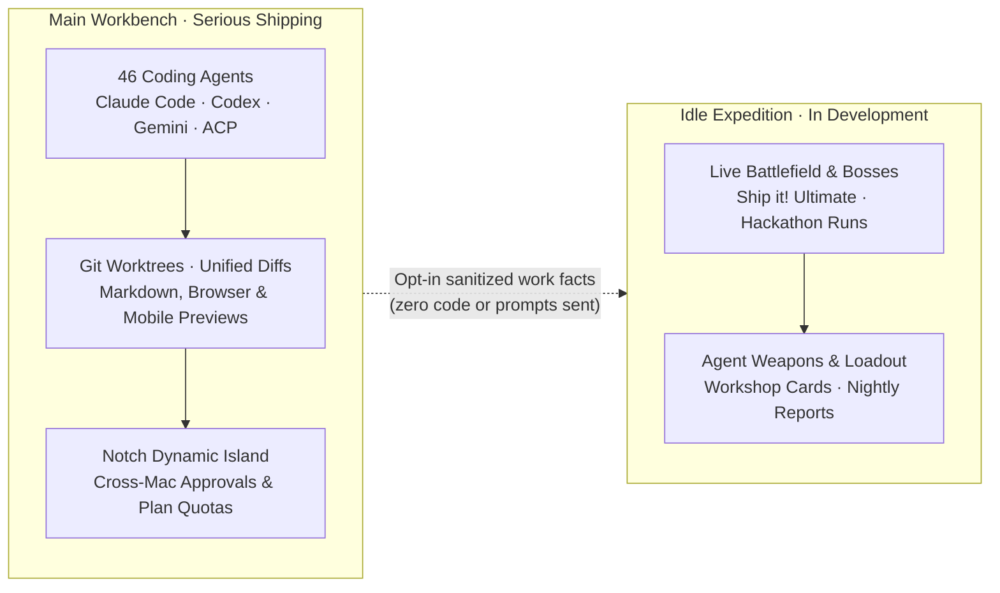

<div align="center">


<h1>Sarto</h1>

**Code while you idle. The native multi-agent ADE for macOS.**

Direct Claude Code, Codex, Gemini CLI and 43 more coding agents in parallel — with a built-in **Idle Expedition** game (_in development_) designed to turn real coding progress into runs, weapons and upgrades while you wait.

Pure SwiftUI & Metal · Notch Dynamic Island · Remote Claude Code · Zero Electron · Zero Telemetry & E2EE

[](#the-dual-loop-ship-code-level-up)
[](#idle-expedition-grind-while-you-code)
[](#pure-mac-craft-prism-notch-and-quotas)
[](#supported-agents)
[](./PRIVACY.md)
[](https://sarto.1o.ink/releases/latest)
[](./LICENSE)

[Download](https://sarto.1o.ink/releases/latest) · [How It Works](#the-dual-loop-ship-code-level-up) · [46 Agents](#main-stage-a-serious-multi-agent-ade) · [Idle Expedition](#idle-expedition-grind-while-you-code) · [Security](./SECURITY.md) · [Privacy](./PRIVACY.md) · [简体中文](./README.zh-CN.md)

</div>

> [!NOTE]
> Sarto is in early, active development: v0.3.2 for macOS 15 or later on Apple silicon.

## The dual loop: ship code, level up

Running three or four coding agents at once creates a new rhythm: bursts of architecture, diff review and approvals separated by two-minute waits while models think and run tests. **Sarto** is an **Agentic Development Environment (ADE)** tailored (_sarto_ in Italian) for both halves of that loop:



## Main stage: a serious multi-agent ADE

- **46 coding agents, your own accounts**: dedicated SDK, server and RPC drivers for **Claude Code**, **Codex**, **OpenCode**, **Pi**, **DeepSeek Harness** and **Cline** (OpenCode and Cline fall back to ACP), plus 40 **Agent Client Protocol (ACP)** agents including **Google Antigravity** (with full context telemetry, subagents, steering and plugins), **Gemini CLI**, **Cursor**, **GitHub Copilot**, **Qwen Code** and **Kimi Code**.
- **Switch or parallelize at will**: isolate parallel agent runs in **Git worktrees**, hand a session to another agent mid-conversation with optional summary, import history from your existing CLIs, or rewind a message and its file edits together.
- **Full workbench around the thread**: two-tier floating composer (`@` files/sessions, `/` commands, model-accurate effort picker, live context & prompt-cache popovers), inline passage comments, per-file Git staging and PR drafting, fast file search and a conflict-safe editor with live Markdown HTML preview, take-over PTY terminals (pausing agents on password prompts), and side-by-side **web browser, iOS simulator and Android emulator** previews.
- **Remote Claude Code**: run Claude Code's model turn on another signed-in Mac of your account while project files, shell commands and permissions stay on the Mac in front of you.
- **Shared memory & MCP Hub**: one global and per-project memory across all agents (with inline approval for proposed global entries), OAuth-ready MCP Hub stored in macOS Keychain, and plugin management for Claude Code, Codex and Antigravity.

## Idle Expedition: grind while you code

> [!NOTE]
> **In development — locked off in v0.3.2.** While the game service and balance are still being finalized, the switch in **Settings** stays locked off, nothing loads in the background, and no game traffic leaves your Mac.

When enabled in an upcoming release, Sarto pairs your collapsible running-sessions rail with an optional **Idle Expedition** companion window:

- **Real coding powers the run**: completed agent turns, tool work and plan steps drive an automated battlefield, Boss challenges, a manual **Ship it!** ultimate and **Nightly Build** summaries.
- **Agent weapons, cards & Hackathon runs**: every coding harness levels up its own weapon alongside Workshop card crafting, 3-to-1 synthesis and roguelike Hackathon runs — fueled by shipping real code rather than mindless clicking.
- **Opt-in and strictly private**: off by default per Mac, gated by an explicit consent sheet before anything is sent, transmitting only minimal opaque work facts (timing, step counts, bucketed token counts and harness type — never source code, prompts, file names or repo paths), with a local upload log you can inspect and instant deletion of unsent facts when turned off.

## Pure Mac craft: Prism, notch and quotas

<table>
<tr>
<td width="33%" valign="top">

**Notch Dynamic Island**<br/>
Concave-shoulder island under the MacBook notch or on chosen displays. Focuses on what needs your attention: live plan progress, usage tab, and cross-Mac permission, question and plan approvals, while honoring Reduce Motion, fullscreen Spaces and display changes.

</td>
<td width="33%" valign="top">

**Menu bar liquid quotas**<br/>
Liquid quota tubes, plan rings, live session banner, model rankings and 7/30/90-day spend & token charts across your agents and Macs. Keeps agents alive when windows close; `⌘Q` confirms twice.

</td>
<td width="33%" valign="top">

**Metal Prism palettes**<br/>
`Obsidian Dark`, `Warm Charcoal`, `Daylight Crystal` and `Warm Alabaster` rendered with Metal, each switching a matching Dock icon at runtime, with thermal- and battery-aware frame pacing. Fully bilingual (EN / 简体中文).

</td>
</tr>
</table>

- **Zero Electron, zero third-party Swift packages**: pure Swift 6, SwiftUI, AppKit and Metal, with Ed25519 + Apple code-signed delta updates that keep the daemon and running sessions alive on app-only updates, plus a headless `sarto` CLI daemon.

## Private by design, across Macs and iPhone

Sarto runs agents with shell access, so **you never have to trust a server with your work**:

- **Local-first**: source code, threads and agent sign-ins stay on your Macs. Zero telemetry, zero analytics, optional account.
- **End-to-end encrypted (`Noise_IK` + `AES-256-GCM`)**: one sidebar connects all trusted Macs of your account (8-character `XXXX-XXXX` commit-then-reveal pairing or 128-bit recovery key) and **Sarto for iPhone** (iPhone Duo foldable-ready, coming to the App Store soon) over padded ciphertext relays and sealed push notifications.
- **Verifiable to the wire**: AGPL-3.0 app and daemon, Apache-2.0 wire spec in [`packages/sarto-wire`](./packages/sarto-wire/PROTOCOL.md), and public [GitHub Actions](./.github/workflows/release-mac.yml) builds with SLSA provenance and `SHA256SUMS.txt`. See [SECURITY.md](./SECURITY.md) and [PRIVACY.md](./PRIVACY.md).

## Tailored from the best

| From                                                        | What Sarto took                                                          |
| ----------------------------------------------------------- | ------------------------------------------------------------------------ |
| [Kettu](https://github.com/KettuAI/Kettu)                   | The daemon and its hosts, which Sarto runs without Electron and extends  |
| [Cindy](https://github.com/makecindy/cindy)                 | The menu bar usage panel and the conversation timeline rail              |
| [Obsidian Prism](https://github.com/RMvdesi/obsidian-prism) | The palettes and the motion of the Prism visual system                   |
| [Code Island](https://github.com/wxtsky/CodeIsland)         | The Dynamic Island's silhouette                                          |
| 46 coding agents                                            | Each one driven in the way it works best, through its SDK, server or ACP |

Full notices live in [THIRD_PARTY_NOTICES.md](./THIRD_PARTY_NOTICES.md).

## Install

- **Mac app** (macOS 15+, Apple silicon, bundles daemon & Node.js): download `Sarto-<version>-arm64.dmg` from [`sarto.1o.ink/releases/latest`](https://sarto.1o.ink/releases/latest) and drag to Applications.
- **Standalone headless daemon** (macOS Apple silicon & Linux x64/arm64, glibc 2.28+, zero root, bundles Node.js):
  ```sh
  curl -fsSL https://sarto.1o.ink/releases/latest/download/install.sh | sh
  ```
  Installs to `~/.local/share/sarto`, links `~/.local/bin/sarto` and sets up a user service (launchd on macOS, `systemd --user` with linger on Linux; pass `sh -s -- --channel beta` for beta or `sh -s -- --no-service` in containers), then run `sarto login` (or add the host over SSH from Sarto on macOS).
- **From source** (Xcode 16+, Node.js 22.13+, pnpm 10 — see [CONTRIBUTING.md](./CONTRIBUTING.md)):
  ```sh
  pnpm install && pnpm build:daemon && open apps/apple/Sarto.xcodeproj
  ```

## Supported agents

<details>
<summary><b>All 46 agents</b></summary>

|                                                                     |                                                                                     |                                                          |                                                                             |
| ------------------------------------------------------------------- | ----------------------------------------------------------------------------------- | -------------------------------------------------------- | --------------------------------------------------------------------------- |
| [Claude Code](https://github.com/anthropics/claude-code)            | [Codex](https://github.com/openai/codex)                                            | [OpenCode](https://opencode.ai)                          | [Pi](https://pi.dev)                                                        |
| [DeepSeek Harness](https://github.com/deepseek-ai/deepseek-harness) | [Cline](https://cline.bot/cli)                                                      | [Google Antigravity](https://antigravity.google)         | [Gemini CLI](https://github.com/google-gemini/gemini-cli)                   |
| [Cursor](https://cursor.com/docs/cli/acp)                           | [GitHub Copilot](https://github.com/github/copilot-cli)                             | [Qwen Code](https://github.com/QwenLM/qwen-code)         | [Kimi Code](https://github.com/MoonshotAI/kimi-code)                        |
| [Grok](https://x.ai/cli)                                            | [Amp](https://ampcode.com)                                                          | [goose](https://block.github.io/goose/)                  | [Kilo Code](https://kilo.ai)                                                |
| [Factory Droid](https://factory.ai/product/cli)                     | [OMP (Oh My Pi)](https://omp.sh)                                                    | [Hermes Agent](https://hermes-agent.nousresearch.com)    | [Devin](https://docs.devin.ai/cli)                                          |
| [Mistral Vibe](https://github.com/mistralai/mistral-vibe)           | [Junie](https://junie.jetbrains.com)                                                | [Auggie CLI](https://github.com/augmentcode/auggie)      | [VT Code](https://github.com/vinhnx/VTCode)                                 |
| [Qoder CLI](https://qoder.com)                                      | [Qoder CN](https://qoder.cn)                                                        | [Codebuddy Code](https://www.codebuddy.cn/cli/)          | [DeepAgents](https://docs.langchain.com/oss/javascript/deepagents/overview) |
| [DimCode](https://dimagent.cn/)                                     | [Dirac](https://dirac.run)                                                          | [GLM Agent](https://github.com/stefandevo/glm-acp-agent) | [Nova](https://www.compassap.ai/portfolio/nova.html)                        |
| [siGit Code](https://github.com/getsigit/sigit)                     | [Agoragentic](https://agoragentic.com)                                              | [Autohand Code](https://www.autohand.ai/cli/)            | [Muse Code](https://dev.meta.ai)                                            |
| [CodeWhale](https://codewhale.net)                                  | [Bob](https://bob.ibm.com)                                                          | [MiniMax Code](https://agent.minimax.io)                 | [Harn](https://harnlang.com)                                                |
| [Kimchi](https://kimchi.dev)                                        | [Cortex Code](https://docs.snowflake.com/en/user-guide/cortex-code/cortex-code-cli) | [Corust Agent](https://corust.ai)                        | [crow-cli](https://github.com/crow-cli/crow-cli)                            |
| [Poolside](https://poolside.ai)                                     | [Stakpak](https://stakpak.dev)                                                      |                                                          |                                                                             |

</details>

## Topics

`ade` · `agentic-development-environment` · `vibe-coding` · `idle-game` · `gamified-coding` · `code-and-chill` · `multi-agent` · `coding-agents` · `macos` · `swiftui` · `metal` · `claude-code` · `codex` · `gemini-cli` · `cursor` · `opencode` · `cline` · `antigravity` · `acp` · `mcp` · `git-worktree` · `dynamic-island` · `end-to-end-encryption`

## Feedback & License

Open an [issue](https://github.com/Rladmsrl/Sarto/issues/new/choose) in any language; report security vulnerabilities privately per [SECURITY.md](./SECURITY.md). Licensed under [AGPL-3.0](./LICENSE) ([`packages/sarto-wire`](./packages/sarto-wire) is Apache-2.0; third-party notices in [THIRD_PARTY_NOTICES.md](./THIRD_PARTY_NOTICES.md)). Independent project, not affiliated with Anthropic, OpenAI, Google, Apple or any agent vendor.
