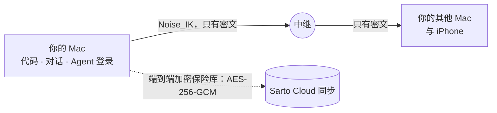

<div align="center">


<h1>Sarto</h1>

**原生、美观、私密的 macOS 编程 Agent 工作台。**

_Sarto_ 在意大利语里是「裁缝」：把各家工具的长处裁剪缝合，做成一件合身的工作台。

[](#安装)
[](#安装)
[](https://sarto.1o.ink/releases/latest)
[](#支持的-agent)
[](./PRIVACY.zh-CN.md)
[](./LICENSE)

[下载](https://sarto.1o.ink/releases/latest) · [安全](./SECURITY.zh-CN.md) · [隐私](./PRIVACY.zh-CN.md) · [English](./README.md)

</div>

> [!NOTE]
> Sarto 处于早期快速开发阶段：当前版本 v0.3.2，支持 Apple 芯片、macOS 15 及以上。

## 隐私为本，人人可验证

Sarto 驱动的 Agent 会读你的代码、执行 Shell 命令，所以它从设计上保证**你无需把工作托付给任何服务器**，而且每一条承诺你都能亲自核实。

- **工作只留在你的 Mac 上。** 源代码、项目文件、对话历史和各 Agent 自己的登录都不会进入 Sarto Cloud。Sarto 没有任何遥测或统计，账号也是可选的。
- **凡是离开本机的，都端到端加密。** 设备之间的连接使用 `Noise_IK_25519_AESGCM_SHA256`，经由只转发填充后密文的中继；设置、MCP 密钥、Skill、主题、记忆与用量的同步，都由只存在于你设备上的 256-bit 密钥加密（`HKDF-SHA256`、`AES-256-GCM`）；推送通知用每台手机自己的密钥封装。
- **开源，直到协议层。** Mac 应用与 daemon 以 AGPL-3.0 开源，Sarto Cloud 使用的每一个协议都写在 Apache-2.0 的 [`packages/sarto-wire`](./packages/sarto-wire/PROTOCOL.md) 里。
- **构建可追溯。** 发布版由 [GitHub Actions](./.github/workflows/release-mac.yml) 从公开 Commit 构建，附带 SLSA 构建溯源证明（自首个公开版本起）与 `SHA256SUMS.txt`。更新必须带有 Sarto 的 Ed25519 签名、且 Apple 代码签名与当前应用一致才会安装。



[SECURITY.zh-CN.md](./SECURITY.zh-CN.md) 与 [PRIVACY.zh-CN.md](./PRIVACY.zh-CN.md) 列出了 Sarto 发出的每一个请求、服务端能看到与看不到的内容，以及校验安装包的命令。

## 亮点

<table>
<tr>
<td width="33%" valign="top">

**美观**<br/>
四套 Metal 光学主题与配套 Dock 图标、克制的动效，以及从刘海里长出来的灵动岛。

</td>
<td width="33%" valign="top">

**原生**<br/>
SwiftUI、AppKit 与 Metal，零第三方 Swift 依赖；菜单栏常驻、`⌘` 快捷键，感知低电量与发热。

</td>
<td width="33%" valign="top">

**46 个 Agent，一个界面**<br/>
Claude Code、Codex、Gemini CLI、Cursor、Copilot、Antigravity 等 46 个，用的都是你自己的安装与账号。

</td>
</tr>
<tr>
<td valign="top">

**博采众长**<br/>
把开发者已经爱用的工具的好点子，缝合成一个风格统一的工作台。

</td>
<td valign="top">

**远程 Claude Code**<br/>
让 Claude Code 的模型跑在你的另一台 Mac 上，文件、命令与权限留在眼前这台。

</td>
<td valign="top">

**Agent 挂机小游戏**<br/>
Agent 一边干活一边打通待办、升级成长。_开发中。_

</td>
</tr>
</table>

## 美观

- **Prism 视觉系统**：`Obsidian Dark`、`Warm Charcoal`、`Daylight Crystal`、`Warm Alabaster` 四套 Metal 绘制的光学主题，各配一枚可实时切换的 Dock 图标；预设强调色与 HSB 色轮，跟随系统、深色或浅色外观，可调对话字号、阅读宽度与终端字体。
- **默认安静**：动效从「关闭」到「极致」分级，遵循「减弱动态效果」；所有动画画布在静止、低电量模式与发热时都会自动降帧。
- **一眼看清的对话流**：连续多步工具调用折叠为单行摘要，可在时间轴上展开；改动以统一 Diff 块呈现；权限、计划与提问卡片永不折叠。
- **富文本回复**：语法高亮与长代码块折叠、GFM 表格、提示框、SVG 与 Mermaid 图表（流程图、时序图、状态图）以及数学公式。
- **完整双语**：每个界面都有英文与简体中文。

## 生于 Mac

- **灵动岛**：凹肩造型，贴合 MacBook 刘海或任意显示器顶部，可在显示器分布图上选一块或多块屏幕。实时显示计划进度，可在任意一台 Mac 上直接处理权限、提问与计划审批，并有会话堆叠、用量页与九点活动指示。
- **菜单栏用量面板**：液态额度柱、套餐圆环、实时会话横幅、今日模型排行，以及跨 Agent、跨 Mac 的 7 / 30 / 90 天堆叠用量图。关闭窗口后 Sarto 与 Agent 仍在菜单栏后台运行；`⌘Q` 需按两次才会关闭窗口。
- **签名自动更新**：正式版与测试版通道、二进制增量更新、SHA-512 与代码签名校验，在退出或离开时安装；仅更新应用时 daemon 与运行中的会话不受影响。
- **独立 daemon**：在无界面的 Mac 上用 `sarto` 命令行运行 daemon（`sarto login`、`status`、`update`、`logs`、`devices`、`terminal`、`service`）。

## 所有 Agent，一个界面

- **6 个原生驱动 + 40 个 ACP Agent**：为 **Claude Code**、**Codex**、**OpenCode**、**Pi**、**DeepSeek Harness** 与 **Cline** 提供专门的 SDK、Server 与 RPC 驱动（OpenCode 与 Cline 可回退到 ACP），另以 Agent Client Protocol 接入 40 个 Agent，包括 **Google Antigravity**、**Gemini CLI**、**Cursor**、**GitHub Copilot**、**Qwen Code** 与 **Kimi Code**。Sarto 自身不实现任何 Agent，驱动的是你自己的安装、账号与配置。
- **深度支持 Antigravity**：上下文明细、逐请求遥测、计划模式、子 Agent、插话、提问表单、插件与套餐额度。
- **Agent 生命周期管理**：检测前置条件，引导安装与更新，按 Agent 设置二进制路径与启动方式，以及 Claude Code、Codex、DeepSeek Harness 与 Antigravity 的默认权限模式。
- **会话中途换 Agent**：两轮之间把会话交给另一个 Agent，携带上下文，也可先做摘要。
- **带上你的历史**：导入你在 Claude Code、Codex、Pi 或任何可列出会话的 ACP Agent 中开始的会话。
- **额度一目了然**：读取各已登录 Agent 在厂商处的套餐额度与余额，并按 API 标价从本地记录统计 Token 与花费。

## 围绕对话的工作台

- **输入框**：双层悬浮输入框，含 Agent 与模型选择、置顶模型、按模型真实能力的思考深度、权限模式、项目与 Git Worktree 选择、`@` 引用文件/目录/会话、`/` 命令、图片与附件、`↑`/`↓` 历史输入，以及上下文、提示缓存与输出速度的实时浮窗。
- **流程控制**：运行中可排队后续消息或插话引导。在 Agent 支持时，可编辑已发消息，让对话连同文件一起回退，反悔了还能放回；也可从任意回复分叉新会话；提示缓存将失效时会提前提醒。
- **内联评论**：对回复中的段落写评论，随下一条消息一起发送。
- **会话看板与子 Agent**：后台命令、监控与子 Agent 的实时进度，内联子 Agent 卡片与会话跳转。
- **随处可找**：`⌘K` 搜索所有已连接 Mac 上的全部会话，`⌘F` 会话内查找，大纲浮窗、时间轴与会话级阅读位置让长对话也好读；任意会话可导出为 Markdown。
- **Git**：相对 `HEAD` 的 Diff 与按文件选择提交、分支与 Worktree 隔离会话、AI 起草提交说明与 Pull Request，以及处理冲突、失败检查、Review、发布与在 GitHub 合并的下一步面板。
- **文件与终端**：项目文件树与编辑器（检测保存冲突、恢复草稿），以及可从 Agent 手中接管再交还的 PTY 终端；终端要求输入密码时，Sarto 会暂停 Agent 输入。
- **预览**：Agent 可检查、可操作（你也可接管）的内置浏览器、iOS 模拟器，以及 Android 模拟器与真机，并排预览。

## 远程 Claude Code

在这台 Mac 上开启 Claude Code 会话，让它的**模型跑在你账号下的另一台 Mac 上**，比如登录了 Claude Code 的那台。项目文件、Shell 命令、权限与 Sarto 的工具都留在你眼前的 Mac；只有模型的回合在远端运行，走同一条端到端加密通道。

- 主机 Mac 的主人开启前默认关闭；可限制并发数量，空闲进程几分钟后自动回收。
- 权限模式从「编辑前询问」到「完全访问」可选；主机离线时会有明确提示。

## 多台 Mac，还有 iPhone

- **所有 Mac 一个侧栏**：本机与账号下其他受信任的 Mac 同在一棵树中，实时显示连接状态，支持跨 Mac 搜索、灵动岛审批，以及远程文件、Git 与终端。一台 Mac 的终端在你于该机开启前，对其他设备保持关闭。
- **端到端加密同步**：用浏览器登录即可创建保险库，并得到一次性的 128-bit 恢复密钥。新 Mac 加入时，在受信任的 Mac 上核对相同的 8 位核对码（`XXXX-XXXX`，commit-then-reveal），或输入恢复密钥。
- **Sarto for iPhone**：原生 iOS 配套应用，原生适配 iPhone Duo 折叠屏，支持端到端加密推送与随时随地审批。

> [!NOTE]
> iOS 应用的 Beta 已完成，即将上架 App Store，目前尚未包含在本仓库中。

## 扩展与记忆

- **MCP Hub**：浏览 Registry 中的服务器或添加自定义服务器，支持 OAuth 登录，并在会话中内联填写 MCP Elicitation 表单。密钥由 macOS 钥匙串加密，只以端到端加密方式同步。
- **Agent 插件**：管理 Claude Code 与 Codex 的插件与插件市场，以及 Antigravity 的插件。
- **记忆**：跨 Agent 共享的全局与项目级记忆。Agent 提议的全局记忆由你审批，你也可以编辑、移动与导入记忆，包括 Claude Code 自己的项目记忆。
- **给 Agent 的 Sarto 工具**：Agent 可通过 MCP 使用 Sarto 的会话、终端、浏览器、设备、记忆与设置。

## Agent RPG

> [!NOTE]
> 开发中：玩法、数值与美术仍在调整。

Agent 工作时，可折叠的右侧栏按 Agent 汇总运行中与待处理的会话，并显示实时额度。当会话有执行计划时，Sarto 与你的 Agent 会组队进入像素风的 **协作 Todo 战斗**：每完成一步就打出一击，Agent 在挂机 RPG 档案里获得经验、装备、勋章与羁绊等级。为了省电，它会从完整动画逐级降到平静与静止。

## 博采众长

Sarto 是一间裁缝铺：别人做得好的，不重新发明，而是把最好的想法拿来，原生地缝合在一起。

| 来自                                                        | Sarto 取了什么                                  |
| ----------------------------------------------------------- | ----------------------------------------------- |
| [Kettu](https://github.com/KettuAI/Kettu)                   | daemon 与各进程架构，Sarto 去掉 Electron 并扩展 |
| [Cindy](https://github.com/makecindy/cindy)                 | 菜单栏用量面板与对话时间轴                      |
| [Obsidian Prism](https://github.com/RMvdesi/obsidian-prism) | Prism 视觉系统的调色板与动效                    |
| [Code Island](https://github.com/wxtsky/CodeIsland)         | 灵动岛的轮廓                                    |
| 46 个编程 Agent                                             | 各按最适合的方式驱动：SDK、Server 或 ACP        |

完整出处与许可见 [THIRD_PARTY_NOTICES.md](./THIRD_PARTY_NOTICES.md)。

## 安装

### Mac 应用

从 [`sarto.1o.ink/releases/latest`](https://sarto.1o.ink/releases/latest) 下载最新版（`Sarto-<版本>-arm64.dmg`），把 Sarto 拖进「应用程序」。需要 Apple 芯片与 macOS 15 及以上，应用自带 daemon 与 Node.js 运行时。

### 独立 daemon

```sh
curl -fsSL https://sarto.1o.ink/releases/latest/download/install.sh | sh
```

安装到 `~/.local/share/sarto`，链接 `~/.local/bin/sarto` 并注册 launchd 用户服务（改为管道到 `sh -s -- --no-service` 可跳过）。然后运行 `sarto login`。

### 从源码构建

需要 Apple 芯片与 macOS 15 及以上、Xcode 16 及以上、Node.js 22.13 及以上与 pnpm 10：

```sh
pnpm install
pnpm build:daemon
open apps/apple/Sarto.xcodeproj
```

运行 **SartoMac** scheme。开发、测试与打包详见 [CONTRIBUTING.md](./CONTRIBUTING.md)。

## 支持的 Agent

<details>
<summary><b>全部 46 个 Agent</b></summary>

|                                                                     |                                                                                     |                                                          |                                                                             |
| ------------------------------------------------------------------- | ----------------------------------------------------------------------------------- | -------------------------------------------------------- | --------------------------------------------------------------------------- |
| [Claude Code](https://github.com/anthropics/claude-code)            | [Codex](https://github.com/openai/codex)                                            | [OpenCode](https://opencode.ai)                          | [Pi](https://pi.dev)                                                        |
| [DeepSeek Harness](https://github.com/deepseek-ai/deepseek-harness) | [Cline](https://cline.bot/cli)                                                      | [Google Antigravity](https://antigravity.google)         | [Gemini CLI](https://github.com/google-gemini/gemini-cli)                   |
| [Cursor](https://cursor.com/docs/cli/acp)                           | [GitHub Copilot](https://github.com/github/copilot-cli)                             | [Qwen Code](https://github.com/QwenLM/qwen-code)         | [Kimi Code](https://github.com/MoonshotAI/kimi-code)                        |
| [Grok](https://x.ai/cli)                                            | [Amp](https://ampcode.com)                                                          | [goose](https://block.github.io/goose/)                  | [Kilo Code](https://kilo.ai)                                                |
| [Factory Droid](https://factory.ai/product/cli)                     | [OMP (Oh My Pi)](https://omp.sh)                                                    | [Hermes Agent](https://hermes-agent.nousresearch.com)    | [Devin](https://docs.devin.ai/cli)                                          |
| [Mistral Vibe](https://github.com/mistralai/mistral-vibe)           | [Junie](https://junie.jetbrains.com)                                                | [Auggie CLI](https://github.com/augmentcode/auggie)      | [VT Code](https://github.com/vinhnx/VTCode)                                 |
| [Qoder CLI](https://qoder.com)                                      | [Qoder CN](https://qoder.cn)                                                        | [Codebuddy Code](https://www.codebuddy.cn/cli/)          | [DeepAgents](https://docs.langchain.com/oss/javascript/deepagents/overview) |
| [DimCode](https://dimagent.cn/)                                     | [Dirac](https://dirac.run)                                                          | [GLM Agent](https://github.com/stefandevo/glm-acp-agent) | [Nova](https://www.compassap.ai/portfolio/nova.html)                        |
| [siGit Code](https://github.com/getsigit/sigit)                     | [Agoragentic](https://agoragentic.com)                                              | [Autohand Code](https://www.autohand.ai/cli/)            | [Muse Code](https://dev.meta.ai)                                            |
| [CodeWhale](https://codewhale.net)                                  | [Bob](https://bob.ibm.com)                                                          | [MiniMax Code](https://agent.minimax.io)                 | [Harn](https://harnlang.com)                                                |
| [Kimchi](https://kimchi.dev)                                        | [Cortex Code](https://docs.snowflake.com/en/user-guide/cortex-code/cortex-code-cli) | [Corust Agent](https://corust.ai)                        | [crow-cli](https://github.com/crow-cli/crow-cli)                            |
| [Poolside](https://poolside.ai)                                     | [Stakpak](https://stakpak.dev)                                                      |                                                          |                                                                             |

</details>

## 反馈

欢迎用任何语言提交 [Issue](../../issues/new/choose)。安全问题请按 [SECURITY.zh-CN.md](./SECURITY.zh-CN.md) 私密上报。

## 许可证

[AGPL-3.0](./LICENSE)，[`packages/sarto-wire`](./packages/sarto-wire) 除外，它采用 Apache-2.0。改编自其他项目的部分保留各自的许可证，见 [THIRD_PARTY_NOTICES.md](./THIRD_PARTY_NOTICES.md)。

Sarto 是独立项目，与 Anthropic、OpenAI、Google、Apple 及任何 Agent 的开发方均无关联，也未获其背书。
