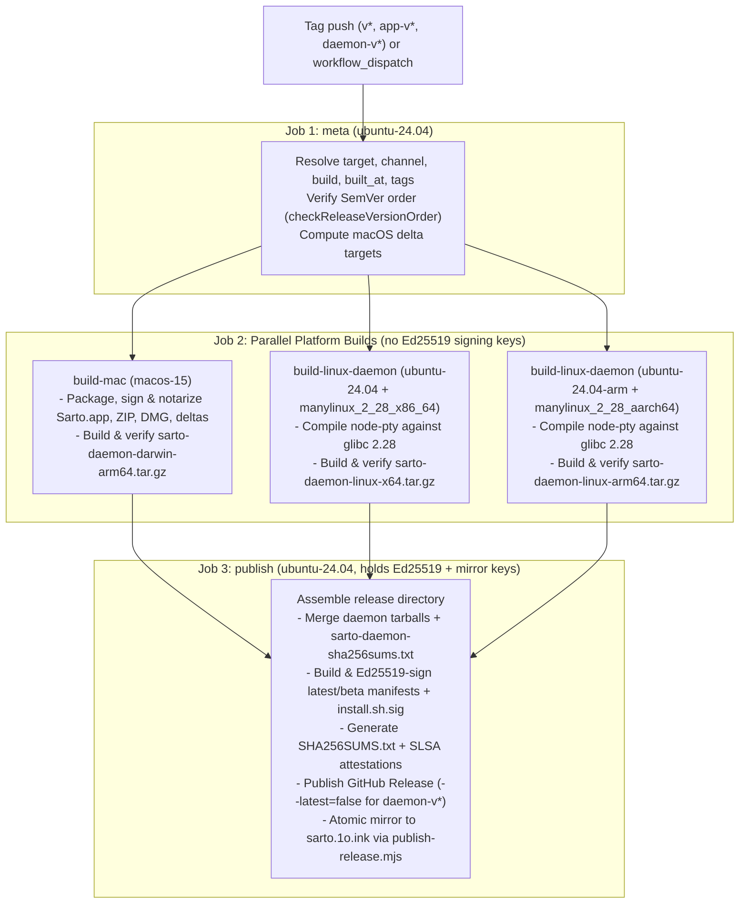

# Headless Linux Daemon Install Script and Release Pipeline Design

Status: Implemented (branch `feat/linux-daemon-release`)

This document designs the end-to-end packaging, installation, service management, and multi-platform release pipeline for Sarto's standalone headless Linux daemon (`linux-x64` and `linux-arm64`), building on the existing daemon runtime, `tools/daemon/package.mjs`, `tools/sarto/install.sh`, and `docs/versioning-and-releases.md`.

## Contents

1. [Background and Current State](#1-background-and-current-state)
2. [Goals and Non-Goals](#2-goals-and-non-goals)
3. [Install Script and Headless Linux UX](#3-install-script-and-headless-linux-ux)
4. [Systemd and Headless Service Hardening](#4-systemd-and-headless-service-hardening)
5. [Linux Packaging and ABI Baseline](#5-linux-packaging-and-abi-baseline)
6. [Multi-Platform Release Architecture](#6-multi-platform-release-architecture)
7. [Security Model and Invariants](#7-security-model-and-invariants)
8. [File Change Plan and Verification Strategy](#8-file-change-plan-and-verification-strategy)
9. [Rollout Plan](#9-rollout-plan)

---

## 1. Background and Current State

Most runtime pieces for a headless Linux daemon already exist in the repository:

| Layer                             | Existing implementation                                                                                                                                         | Gap today                                                                                                   |
| --------------------------------- | --------------------------------------------------------------------------------------------------------------------------------------------------------------- | ----------------------------------------------------------------------------------------------------------- |
| Daemon runtime & XDG paths        | `src/daemon/main.ts` (`SUPPORTED = ['darwin', 'linux']`), `src/daemon/paths.ts` (`~/.local/share/sarto`, `~/.local/state/sarto/logs`)                           | None for core execution                                                                                     |
| Credential storage                | `src/daemon/keychain.ts` falls back to `NO_SYSTEM_ENCRYPTION` (`0600` files) on non-macOS                                                                       | None                                                                                                        |
| Service management                | `src/daemon/service.ts` writes `~/.config/systemd/user/sarto.service` and runs `loginctl enable-linger`                                                         | Missing `XDG_RUNTIME_DIR` / D-Bus fallback in non-PAM SSH or `su` shells; rough UX when systemd is absent   |
| Daemon packaging                  | `tools/daemon/package.mjs` supports `linux-x64` and `linux-arm64`, omits `@expo/serve-sim` on Linux                                                             | `node-pty@1.1.0` ships no Linux prebuilds; must build inside a glibc 2.28 baseline container                |
| Install & uninstall scripts       | `tools/sarto/install.sh` and `tools/sarto/uninstall.sh` detect `linux-x64`/`linux-arm64`, reject musl, support `--no-service`                                   | No `--channel beta` flag for manual installs; no upfront glibc version check; minimal post-install guidance |
| Updater & multi-platform manifest | `src/daemon/update.ts` verifies Ed25519-signed `latest-daemon.json` / `beta-daemon.json` with `files[]` and passes all pinned `--sha256` values to `install.sh` | Ready for multi-platform `files[]`                                                                          |
| Release pipeline                  | `tools/sarto/release.mjs` and `.github/workflows/release-mac.yml`                                                                                               | Hard-gated to `darwin-arm64`; only builds and signs `sarto-daemon-darwin-arm64.tar.gz`                      |

The remaining work is therefore concentrated in three areas:

1. Hardening `tools/sarto/install.sh` and `src/daemon/service.ts` for real-world headless Linux hosts (VPS, cloud VMs, SSH-only accounts, WSL2, containers).
2. Compiling and verifying `sarto-daemon-linux-x64.tar.gz` and `sarto-daemon-linux-arm64.tar.gz` against a strict `glibc 2.28` ABI floor.
3. Refactoring the release scripts and GitHub Actions workflow into a multi-platform build-then-assemble-and-sign pipeline.

---

## 2. Goals and Non-Goals

### Goals

- Ship `sarto-daemon-linux-x64.tar.gz` and `sarto-daemon-linux-arm64.tar.gz` alongside `sarto-daemon-darwin-arm64.tar.gz` in every `v*.*.*` and `daemon-v*.*.*` release (both `stable` and `beta`).
- Keep the installation zero-root and self-contained under `~/.local/share/sarto/versions/<version>` with `~/.local/bin/sarto` symlinked, compatible with both manual `curl | sh` installation and SartoMac's SSH provisioning (`src/remote-host/ssh.ts`).
- Guarantee binary portability on mainstream Linux distributions with `glibc >= 2.28` (Ubuntu 20.04+, Debian 10+, RHEL/Rocky/Alma 8+, Fedora, Arch, WSL2).
- Keep the release signing trust boundary tight: Ed25519 release private keys are used only in the final assembly/publish job, never inside native build jobs.
- Preserve full backwards compatibility with existing `sarto update`, `sarto ssh-setup`, `install.sh` flags, and `sarto.1o.ink` release routing rules.

### Non-Goals

- **musl / Alpine Linux**: Official Node.js 24 binaries and Sarto's glibc ABI baseline do not target musl. `install.sh` continues to fail fast with a clear message.
- **Distro system packages (`.deb`, `.rpm`, AUR, Homebrew)**: Deferred to a later phase; user-space installation avoids `sudo`, enables `sarto update` self-upgrades, and works identically over SSH provisioning.
- **Desktop/iOS host features on Linux**: iOS simulators, physical iOS capture helpers, and macOS Computer Use remain macOS-only (`src/device-host/discovery.ts` already guards `xcrun` on `darwin`; Android `adb` and `scrcpy-server` continue to work on Linux).

---

## 3. Install Script and Headless Linux UX

### 3.1 User-Facing Commands

```sh
# Stable (default)
curl -fsSL https://sarto.1o.ink/releases/latest/download/install.sh | sh

# Beta channel
curl -fsSL https://sarto.1o.ink/releases/latest/download/install.sh | sh -s -- --channel beta

# Container / CI / non-systemd host (skip systemd setup)
curl -fsSL https://sarto.1o.ink/releases/latest/download/install.sh | sh -s -- --no-service

# Pinned version (also used by sarto update and SartoMac SSH provisioning)
curl -fsSL https://sarto.1o.ink/releases/latest/download/install.sh | sh -s -- --version 0.4.0

# Decoupled tag (e.g. daemon-only beta)
curl -fsSL https://sarto.1o.ink/releases/latest/download/install.sh | sh -s -- --version 0.4.0-beta.261127153000 --tag daemon-v0.4.0-beta.261127153000
```

### 3.2 Option Additions and Compatibility

All existing flags (`--version`, `--tag`, `--sha256`, `--no-service`, `-h`/`--help`) and `SARTO_RELEASES_URL` stay backwards-compatible.

Add one user-facing option:

- `--channel stable|beta` (default: `stable`)
  - Rejected if combined with `--version` or `--tag` (to avoid ambiguous precedence).
  - When `--channel beta` is passed:
    1. Downloads `$base/latest/download/beta-daemon.json` and `$base/latest/download/latest-daemon.json` (if present).
    2. Extracts top-level `"version"` and `"tag"` using POSIX `awk` (no `jq` or `python` dependency; release manifests are emitted with canonical 2-space JSON formatting).
    3. Compares SemVer (or uses `beta-daemon.json` when newer, matching `sarto update --channel beta` graduation semantics) and fetches from `$base/download/<tag>`.
  - When `--channel stable` (default) with no `--version`/`--tag`:
    - Keeps fetching `$base/latest/download`, which Sarto Cloud resolves through the `latest-daemon` pointer (or `latest-daemon.json` when using GitHub Releases fallback).

### 3.3 Preflight Environment Checks on Linux

Before downloading the ~50 MB archive, `install.sh` performs fast, zero-dependency checks:

1. **OS & Architecture**:
   - `Linux` + `x86_64|amd64` -> `linux-x64`
   - `Linux` + `aarch64|arm64` -> `linux-arm64`
   - Reject anything else before network calls.
2. **libc & glibc >= 2.28 check**:
   - Reject musl (`ldd --version` containing `musl`, or `/lib/ld-musl-*.so*` present when `ldd` is missing).
   - If `getconf GNU_LIBC_VERSION` outputs `glibc <major>.<minor>`, check `(major > 2) || (major == 2 && minor >= 28)` and fail fast with:
     `The Sarto daemon needs glibc 2.28 or later (found glibc X.Y).`
   - Keep the post-unpack `"$package/bin/sarto" --version` check as the authoritative runtime verification.
3. **Required POSIX tools**:
   - `curl` or `wget`
   - `sha256sum` or `shasum`
   - `tar` (plus `gzip` availability check when `tar -xzf` requires external `gzip` on minimal images)
4. **Symlink safety**:
   - Retain existing guard: refuse to overwrite `~/.local/bin/sarto` if it is not a symlink into `~/.local/share/sarto/versions/*/bin/sarto`.

### 3.4 Service Installation Behavior in Containers vs Servers

- **Normal Linux host with systemd** (`/run/systemd/system` exists and `systemctl` is on `PATH`):
  - Runs `"$target/bin/sarto" service install`.
  - If `service install` fails, exit non-zero with actionable remediation (keeps SartoMac's SSH provisioning error handling deterministic).
- **Explicit `--no-service`**:
  - Skips service setup and prints `Start it with sarto run, or set up its service with sarto service install.`
- **Host without systemd** (e.g. Docker container with `/.dockerenv` or `/run/.containerenv`, WSL1, OpenRC):
  - `sarto service install` detects the missing systemd init (`/run/systemd/system` absent or `systemctl` missing) and exits with a clear message explaining that systemd is not running on this host and advising `--no-service` + `sarto run`.
  - Rationale: Do not silently succeed without starting the daemon when `--no-service` was not passed, because `src/remote-host/ssh.ts` runs `install.sh` without `--no-service` and expects `sarto ssh-setup` to reach a running daemon immediately after.

### 3.5 Post-Install Next Steps Output

When running interactively (or after manual installation), print concise next steps:

1. Remind to add `~/.local/bin` to `PATH` if missing (existing behavior).
2. If `sarto service install` printed a linger warning, highlight `sudo loginctl enable-linger <user>`.
3. Print a 2-line quickstart:
   - `sarto status` to inspect the running daemon
   - `sarto login` to connect via Sarto Cloud, or add this host over SSH from Sarto on macOS

---

## 4. Systemd and Headless Service Hardening

Changes scoped to `src/daemon/service.ts`:

### 4.1 User Bus Environment Resolution on Linux

On headless Linux servers accessed via `su - user`, `sudo -u user`, or stripped SSH environments, `XDG_RUNTIME_DIR` and `DBUS_SESSION_BUS_ADDRESS` are often unset even though `systemd --user` is active for that UID.

Before invoking `systemctl --user` in `src/daemon/service.ts`:

1. Check `/run/systemd/system` exists; if not, throw `ServiceError('systemd is not running on this system; run sarto run in the foreground or manage it with your init system')`.
2. Build the child `env` for `systemctl`:
   - If `XDG_RUNTIME_DIR` is unset and `/run/user/${deps.uid}` exists and is a directory, set `XDG_RUNTIME_DIR=/run/user/${deps.uid}`.
   - If `DBUS_SESSION_BUS_ADDRESS` is unset and `${XDG_RUNTIME_DIR}/bus` exists, set `DBUS_SESSION_BUS_ADDRESS=unix:path=${XDG_RUNTIME_DIR}/bus`.
3. Keep `Restart=always`, `RestartSec=2`, and `KillMode=mixed` in `systemdUnit()`.
4. Add `TimeoutStopSec=25` to `systemdUnit()` to match macOS's `EXIT_TIMEOUT_S = 20` plus margin so host processes finish draining gracefully before `SIGKILL`.
5. Keep `loginctl enable-linger` non-fatal with the existing `sudo loginctl enable-linger <user>` warning.

### 4.2 Unattended / Headless Upgrade Safety

- `sarto update` verifies `latest-daemon.json` (or `beta-daemon.json`) and `install.sh` with Ed25519, downloads the archive, checks its SHA-256 against the signed manifest's `files[]`, atomically swaps `~/.local/bin/sarto`, retains the previous version folder for manual rollback, and re-runs `sarto service install` (which executes `systemctl --user daemon-reload && systemctl --user restart sarto.service`).
- `systemd` unit `ExecStart` points to the newly installed version's bundled `node` and `daemon/main.cjs`, so `restart` cleanly transitions to the new runtime.

---

## 5. Linux Packaging and ABI Baseline

### 5.1 Native Dependency Audit

From `package.json`:

| Runtime dependency           | Native addon?                                   | Linux handling                                                                                             |
| ---------------------------- | ----------------------------------------------- | ---------------------------------------------------------------------------------------------------------- |
| `node-pty` (`1.1.0`)         | Yes (`pty.node`)                                | Ships prebuilds only for `darwin-*` and `win32-*`; **must compile on Linux per arch (`x64`, `arm64`)**     |
| `agent-device` (`0.21.36`)   | No (pure JS/ESM, zero runtime npm dependencies) | Copied verbatim by `tools/daemon/package.mjs`                                                              |
| `decompress` (`4.2.1`)       | No                                              | Loaded at runtime when unpacking agent archives                                                            |
| `@expo/serve-sim` (optional) | macOS arm64 only                                | Excluded on Linux by `tools/daemon/package.mjs`                                                            |
| `out/helpers/scrcpy-server`  | No (Android-side dex)                           | Downloaded & SHA-256 verified by `tools/install/device-helpers.mjs`; iOS native helpers skipped on Linux   |
| Bundled Node.js (`24.22.2`)  | Official binary                                 | Downloaded & SHA-256 verified from `nodejs.org` for `linux-x64` / `linux-arm64` (requires `glibc >= 2.28`) |

### 5.2 Avoiding glibc Symbol Creep

GitHub's `ubuntu-24.04` runners ship `glibc 2.39`. Building `node-pty` directly on the runner host risks linking symbols such as `GLIBC_2.33`/`GLIBC_2.34`/`GLIBC_2.38`, breaking Ubuntu 20.04/22.04, Debian 11/12, and RHEL 8/9.

**Design decision**: Build and package Linux daemons inside **`quay.io/pypa/manylinux_2_28_x86_64`** (on `ubuntu-24.04`) and **`quay.io/pypa/manylinux_2_28_aarch64`** (on `ubuntu-24.04-arm`), which provide modern GCC toolchains strictly linked against `glibc 2.28`—matching Node.js 24's exact floor.

### 5.3 Per-Package Build & Verification Steps

Introduce a cross-platform single-target script `tools/sarto/build-daemon-package.mjs`:

```sh
node tools/sarto/build-daemon-package.mjs \
  --version <daemonVersion> \
  --build <12-digits> \
  --channel <stable|beta> \
  --commit <sha> \
  --built-at <iso-timestamp> \
  --out <artifact-dir>
```

Steps executed on the target platform (`darwin-arm64`, `linux-x64`, or `linux-arm64`):

1. Build daemon bundle with `SARTO_BUILD_PLACEHOLDER=1 pnpm build:daemon` (if not already provided via `--build-dir`).
2. Fetch device helpers via `node tools/install/device-helpers.mjs` (fetches `scrcpy-server` on Linux; also builds iOS helpers on macOS).
3. Run `packageDaemon()` from `tools/daemon/package.mjs` with `cacheDir: null` (always verifies Node.js archive against `nodejs.org/dist/v<ver>/SHASUMS256.txt`).
4. Unpack, run `stampBuildInfo()` to inject `version`, `build`, `channel`, `commit`, `builtAt`, and assert `stamped > 0`.
5. Run automated package verification gates before producing the final tarball:
   - **CLI version gate**: `<pkg>/bin/sarto --version` outputs exact `<daemonVersion>`.
   - **Linux glibc ABI gate** (`platform === 'linux'`): inspect `objdump -T <pkg>/daemon/node_modules/node-pty/build/Release/pty.node` and fail if any `GLIBC_X.Y` symbol exceeds `2.28`.
   - **PTY smoke gate**: execute `<pkg>/node/bin/node` to `require('./daemon/node_modules/node-pty')`, spawn `/bin/sh -c 'echo sarto-pty-ok'`, and assert output + exit code `0`.
   - **Headless daemon smoke gate**: spawn `<pkg>/bin/sarto run` with an isolated temp `SARTO_DAEMON_DATA` and `SARTO_NO_KEYCHAIN=1`, verify `<pkg>/bin/sarto status` returns healthy host status, then terminate cleanly with `SIGTERM`.
6. Repack `sarto-daemon-<platform>-<arch>.tar.gz` (deterministic tar options: `COPYFILE_DISABLE=1`, normalized permissions) and emit a metadata sidecar `sarto-daemon-<platform>-<arch>.meta.json`:

```json
{
  "platform": "linux",
  "arch": "x64",
  "name": "sarto-daemon-linux-x64.tar.gz",
  "size": 52428800,
  "sha256": "...",
  "version": "0.4.0",
  "build": "261127153000",
  "channel": "stable"
}
```

---

## 6. Multi-Platform Release Architecture

### 6.1 Pipeline Overview



### 6.2 Shared Assembly and Signing Script

Introduce `tools/sarto/assemble-daemon-release.mjs`:

```sh
node tools/sarto/assemble-daemon-release.mjs \
  --in <dir-with-tarballs-and-meta> \
  --out <dist/release/<daemonTag>> \
  --version <daemonVersion> \
  --tag <daemonTag> \
  --channel <stable|beta> \
  --build <12-digits> \
  --built-at <iso-timestamp> \
  [--require-platforms darwin-arm64,linux-x64,linux-arm64] \
  [--harness-checks <file>]
```

Responsibilities:

1. Discovers all `sarto-daemon-<platform>-<arch>.tar.gz` artifacts in `--in`, recomputes each file's `size` and `sha256` directly from bytes on disk, and requires the `.meta.json` sidecar beside each one to name the same `sha256` and the release's `version`, `build` and `channel`, so an archive left over from another build is never signed into a manifest (the install script would refuse it on every computer once it reports its version).
2. Validates that all `--require-platforms` targets are present (defaulting to `darwin-arm64,linux-x64,linux-arm64` in CI so a silently dropped platform fails the release before publishing).
3. Sorts entries deterministically by `(platform, arch)` and writes:
   - `sarto-daemon-darwin-arm64.tar.gz`
   - `sarto-daemon-linux-x64.tar.gz`
   - `sarto-daemon-linux-arm64.tar.gz`
   - `sarto-daemon-sha256sums.txt` (all three lines, standard `sha256sum` two-space format)
   - `install.sh` + `install.sh.sig`
   - `latest-daemon.json` + `latest-daemon.json.sig` (or `beta-daemon.json` + `beta-daemon.json.sig`)
   - Optional `harnesses.json` when `--harness-checks` is passed
4. Signs every file using `signerFrom('release', 'SARTO_UPDATE_SIGNING_KEY')` and `updateFileMessage(name, bytes)`—exact byte-for-byte parity with `tools/sarto/signing.mjs` and `src/daemon/update.ts`.

### 6.3 Multi-Platform Daemon Manifest Format

No schema breaking change is needed—`src/daemon/update.ts` already parses `files[]` up to `MAX_MANIFEST_FILES = 16`:

```json
{
  "version": "0.4.0",
  "channel": "stable",
  "build": "261127153000",
  "tag": "daemon-v0.4.0",
  "releaseDate": "2026-11-27T15:30:00.000Z",
  "files": [
    {
      "platform": "darwin",
      "arch": "arm64",
      "name": "sarto-daemon-darwin-arm64.tar.gz",
      "size": 49123456,
      "sha256": "..."
    },
    {
      "platform": "linux",
      "arch": "arm64",
      "name": "sarto-daemon-linux-arm64.tar.gz",
      "size": 50234567,
      "sha256": "..."
    },
    {
      "platform": "linux",
      "arch": "x64",
      "name": "sarto-daemon-linux-x64.tar.gz",
      "size": 51345678,
      "sha256": "..."
    }
  ]
}
```

### 6.4 Keeping Local macOS `tools/sarto/release.mjs` Working

- `tools/sarto/release.mjs` remains usable locally on Apple silicon Macs for single-machine test/emergency releases:
  - Calls `build-daemon-package.mjs` for `darwin-arm64` and `assemble-daemon-release.mjs` (without `--require-platforms` when running locally, or accepts `--extra-daemon-dir <dir>` to fold in prebuilt Linux tarballs).
  - Supports `--skip-update-sign` (for CI `build-mac` job, which emits unsigned `latest-mac.json` / `beta-mac.json` to be signed in the `publish` job).
- For `target=app` releases, `build-linux-daemon` is skipped automatically (`if: needs.meta.outputs.wants_daemon == 'true'`).
- For `target=daemon` releases, `build-mac` runs only the lightweight daemon build (no Xcode build, no notarization, no DMG/delta), finishing in ~2 minutes in parallel with Linux builds.

### 6.5 GitHub Actions Workflow Trigger & Runner Layout

Update `.github/workflows/release-mac.yml` (or rename to `.github/workflows/release.yml` and update doc references):

- Triggers unchanged:
  - Tag push: `v*.*.*`, `app-v*.*.*`, `daemon-v*.*.*`
  - Manual `workflow_dispatch`: `target` (`all|app|daemon`), `channel` (`stable|beta`), `version`, `daemon_version`, `draft`
- Runners:
  - `meta`: `ubuntu-24.04`
  - `build-mac`: `macos-15` (Apple silicon)
  - `build-linux-daemon`:
    - `x64`: `ubuntu-24.04` with `container: quay.io/pypa/manylinux_2_28_x86_64`
    - `arm64`: `ubuntu-24.04-arm` with `container: quay.io/pypa/manylinux_2_28_aarch64`
  - `publish`: `ubuntu-24.04`
- **Shared timestamp & build number**: `meta` generates `build` and `built_at` once and passes them as job outputs so all three platform packages and manifests carry identical metadata.
- **Sarto Cloud mirror (`tools/sarto/publish-release.mjs`)**: No protocol changes required. `publish-release.mjs` already `rsync`s the entire `<tag>/` directory (including all three tarballs, `sarto-daemon-sha256sums.txt`, `install.sh`, `install.sh.sig`) before atomically renaming `latest-daemon.json`, `latest-daemon.json.sig`, `latest-daemon`, and (for shared `vX.Y.Z`) `latest`.

---

## 7. Security Model and Invariants

1. **Least-privilege signing separation**:
   - `build-mac` receives only Apple signing/notarization secrets (`SARTO_SIGN_IDENTITY`, `MACOS_CERT_*`, `SARTO_NOTARY_*`).
   - `build-linux-daemon` receives **no release secrets at all**.
   - `publish` is the sole job receiving `SARTO_UPDATE_SIGNING_KEY`, `SARTO_HARNESSES_SIGNING_KEY`, and `SARTO_PUBLISH_SSH_KEY`.
2. **End-to-end integrity for updates**:
   - `sarto update` verifies `latest-daemon.json.sig` (or `beta-daemon.json.sig`) and `install.sh.sig` with keys compiled into the daemon (`tools/sarto/update-keys.json`).
   - `sarto update` passes every SHA-256 listed in the signed manifest to `install.sh --sha256 ...`; `install.sh` refuses any tarball whose hash is not in that signed set, never trusting the unsigned `sarto-daemon-sha256sums.txt` during updates.
   - Optional improvement in `src/daemon/update.ts`: filter `files[]` by matching `sarto-daemon-${platform}-${arch}.tar.gz` when `files` entries carry platform names (falling back to all `files` if none match), so each host pins its exact single expected SHA-256.
3. **Domain-separated signatures**:
   - Signature input remains `"<filename>\n" + bytes` (`updateFileMessage`), preventing cross-channel or cross-component replay.
4. **Pointer isolation**:
   - Standalone `daemon-v*` GitHub Releases continue using `--latest=false`, and beta releases use `--prerelease`.
5. **Zero-root local installation**:
   - `install.sh` never invokes `sudo`, never mutates `/usr/local`, and never overwrites a non-Sarto `~/.local/bin/sarto`.

---

## 8. File Change Plan and Verification Strategy

### Planned Code Changes

| File                                                              | Change                                                                                                                                                            |
| ----------------------------------------------------------------- | ----------------------------------------------------------------------------------------------------------------------------------------------------------------- |
| `tools/sarto/build-daemon-package.mjs` (new)                      | Cross-platform standalone daemon build, metadata stamping, glibc 2.28 ABI check, PTY & headless startup smoke tests                                               |
| `tools/sarto/assemble-daemon-release.mjs` (new)                   | Multi-platform tarball collector, `sarto-daemon-sha256sums.txt` generator, manifest builder, Ed25519 signer                                                       |
| `tools/sarto/release.mjs`                                         | Delegate daemon build/assembly to the two new modules; allow `--skip-update-sign` for CI `build-mac` and `--extra-daemon-dir` for local multi-platform runs       |
| `tools/sarto/install.sh`                                          | Add `--channel stable \| beta`, upfront `glibc >= 2.28` check, tool availability checks, and headless next-steps output                                           |
| `src/daemon/service.ts`                                           | Detect missing `/run/systemd/system` cleanly; auto-populate `XDG_RUNTIME_DIR` / `DBUS_SESSION_BUS_ADDRESS` when `/run/user/<uid>` exists; add `TimeoutStopSec=25` |
| `src/daemon/update.ts`                                            | Narrow pinned `--sha256` to the host's `sarto-daemon-<platform>-<arch>.tar.gz` entry when present in signed manifest `files[]`                                    |
| `.github/workflows/release-mac.yml` (or `release.yml`)            | Split into `meta` -> (`build-mac`, `build-linux-daemon[x64, arm64]`) -> `publish`                                                                                 |
| `src/daemon/update.test.ts`                                       | Add multi-platform `files[]` manifest test coverage                                                                                                               |
| `docs/versioning-and-releases.md`, `README.md`, `README.zh-CN.md` | Document Linux daemon installation (`stable`, `beta`, `--no-service`), supported distros (`glibc >= 2.28`), and multi-platform release flow                       |

### Verification Matrix

- **Unit & security tests**:
  - `pnpm format:check && pnpm lint && pnpm typecheck && pnpm test`
  - Multi-platform manifest signature verification & platform-specific `--sha256` pinning tests in `src/daemon/update.test.ts`
  - Unit tests for `assemble-daemon-release.mjs` (missing required platform fails; deterministic checksums; signature verifies against `src/daemon/update.ts`)
- **Linux container integration tests** (run in CI on every Linux daemon build):
  - `ubuntu:20.04` (glibc 2.31), `debian:11` (glibc 2.31), `debian:12` (glibc 2.36), `ubuntu:24.04` (glibc 2.39): install with `--no-service` against a local HTTP test server, verify `sarto --version`, `sarto run`, `sarto status`, and `node-pty` spawn.
  - `alpine:3.20` (musl): verify `install.sh` fails cleanly with the musl error before downloading.
- **End-to-end real VM & SSH test** (beta release):
  - Cut a beta tag strictly newer than `v0.3.2` (e.g. `daemon-v0.3.3-beta.<build>`, per SemVer monotonicity rules).
  - Test fresh `curl | sh -s -- --channel beta` on a real systemd Linux host (both `x64` and `arm64`).
  - Test `sarto service install`, logout/re-login persistence with linger, `sarto update --channel beta`, and adding the Linux host via SSH from SartoMac.

---

## 9. Rollout Plan

1. **Phase 1 — Scripts & Service Hardening**: Implement `build-daemon-package.mjs`, `assemble-daemon-release.mjs`, `release.mjs` refactor, `install.sh` enhancements, `src/daemon/service.ts` user-bus hardening, and `src/daemon/update.ts` per-platform hash pinning + tests.
2. **Phase 2 — Multi-Platform CI & Beta Validation**: Roll out the 4-job GitHub Actions release workflow, dispatch a draft `daemon-v0.3.3-beta.<build>` release, verify artifacts on `x64` and `arm64` Linux hosts (including older glibc distros and SSH provisioning from SartoMac).
3. **Phase 3 — Documentation & Stable Ship**: Update `README.md`, `README.zh-CN.md`, and `docs/versioning-and-releases.md`, then ship with the next stable release.
