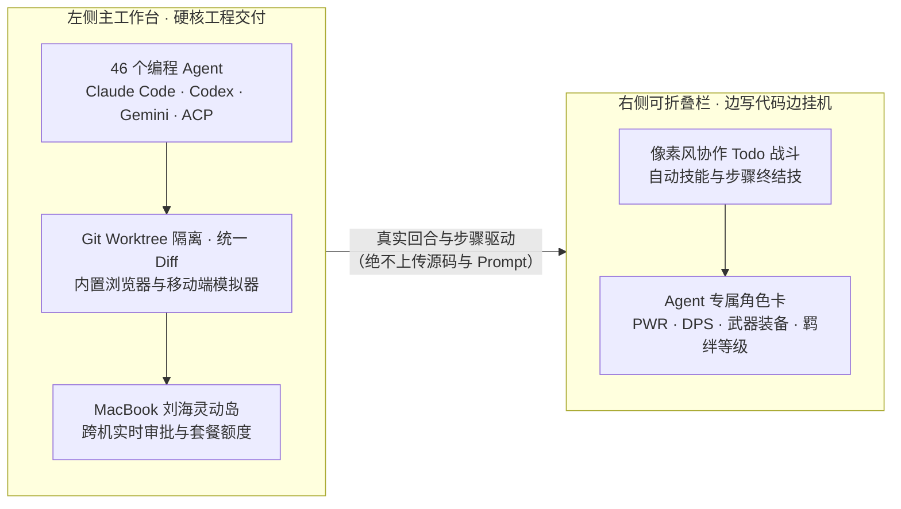

<div align="center">


<h1>Sarto</h1>

**边 Coding 边挂机。生于 macOS 的原生多 Agent 智能体开发环境（ADE）。**

同时调度 Claude Code、Codex、Gemini CLI 等 46 个编程 Agent 并行交付代码；每一次真实编码与计划推进，都会化作右侧栏像素 **Agent 挂机 RPG** 里的连击、掉落与升阶。

纯原生 SwiftUI + Metal · 刘海灵动岛 · 远程 Claude Code · 零 Electron · 零遥测端到端加密

[](#双循环左边硬核交付右边轻松挂机)
[](#右侧栏边-coding-边挂机的像素-rpg)
[](#纯血-mac-质感prism灵动岛与液态额度)
[](#支持的-agent)
[](../../PRIVACY.zh-CN.md)
[](https://sarto.1o.ink/releases/latest)
[](../../LICENSE)

[下载](https://sarto.1o.ink/releases/latest) · [双循环玩法](#双循环左边硬核交付右边轻松挂机) · [46 个 Agent](#主舞台严肃硬核的多-agent-ade) · [挂机 RPG](#右侧栏边-coding-边挂机的像素-rpg) · [安全](../../SECURITY.zh-CN.md) · [隐私](../../PRIVACY.zh-CN.md) · [English](./README-B-vibe-idle.md)

</div>

> [!NOTE]
> Sarto 处于早期快速开发阶段：当前版本 v0.3.2，支持 Apple 芯片、macOS 15 及以上。

## 双循环：左边硬核交付，右边轻松挂机

同时开着三四个 Agent 写代码时，工作节奏变成了「密集拆解需求、审 Diff、批权限」与「等模型思考、跑单测的两分钟空档」交替出现。**Sarto**（意大利语「裁缝」）是专为这两种状态量身缝合的 **智能体开发环境（ADE）**：



## 主舞台：严肃硬核的多 Agent ADE

- **46 个编程 Agent，复用自有账号**：为 **Claude Code**、**Codex**、**OpenCode**、**Pi**、**DeepSeek Harness** 与 **Cline** 提供专门的 SDK、Server 与 RPC 原生驱动，另通过 **ACP（Agent Client Protocol）** 接入 40 个 Agent，含深度适配的 **Google Antigravity**（上下文明细、逐请求遥测、子 Agent、插话与插件）、**Gemini CLI**、**Cursor**、**GitHub Copilot**、**Qwen Code** 与 **Kimi Code**。
- **自由并行与中途接力**：用 **Git Worktree** 隔离并行跑多个 Agent；两轮之间带上下文把会话交给另一个 Agent；一键导入各 CLI 历史会话；编辑已发消息即可连同文件改动一起回退，反悔还能恢复。
- **围绕对话的完整开发台**：双层悬浮输入框（`@` 引用文件/会话、`/` 命令、思考深度、实时上下文与缓存浮窗）、段落内联评论、按文件暂存提交与 AI 起草 PR、防冲突文件编辑器、可随时接管再交还的 PTY 终端（遇密码提示自动暂停 Agent），以及并排的 **内置浏览器、iOS 模拟器与 Android 模拟器/真机** 预览。
- **远程 Claude Code**：让 Claude Code 的模型回合跑在你账号下另一台已登录的 Mac 上，而项目文件、Shell 命令与权限全部留在眼前这台 Mac。
- **跨 Agent 记忆与 MCP Hub**：所有 Agent 共享全局与项目记忆；MCP 密钥存入 macOS 钥匙串；集中管理 Claude Code、Codex 与 Antigravity 插件。

## 右侧栏：边 Coding 边挂机的像素 RPG

> [!NOTE]
> 开发中：玩法、数值与美术仍在调整。

在可折叠的右侧运行栏里，Sarto 把多会话状态监控、厂商实时额度条与一款零打扰的 **Agent 挂机 RPG** 融为一体：

- **像素协作 Todo 战斗**：只要会话立了计划，Sarto 就和你的编程 Agent 在像素舞台并肩作战——真实编码回合会发射弹幕与自动技能，每完成一步计划就打出一记终结重击。
- **把常用 Agent 养成主力角色**：每个 Agent 都有独立角色卡——段位头衔、战力（`PWR`）、秒伤（`DPS`）、武器配装、勋章与指挥官羁绊等级，不靠无脑连点，全靠每天写代码、重构、修 Bug 自然掉落养成。
- **四级省电与静默纪律**：从热血的 **街机（Arcade）** 战斗（武器特效、技能与像素伤害跳字）平滑降到 **安静**、**静止** 或 **关闭**；窗口静止、低电量模式与机身发热时自动降帧。
- **挂机也绝不泄密**：结算只读取脱敏的耗时与步骤计数——源代码、Prompt、文件名与仓库路径永不离开你的 Mac。

## 纯血 Mac 质感：Prism、灵动岛与液态额度

<table>
<tr>
<td width="33%" valign="top">

**刘海凹肩灵动岛**<br/>
从 MacBook 刘海或指定显示器顶部自然生长。实时展示计划进度，跨 Mac 直接审批权限、回答提问与确认计划。

</td>
<td width="33%" valign="top">

**菜单栏液态额度面板**<br/>
液态额度柱、套餐圆环、实时会话横幅、模型排行与 7/30/90 天跨机用量图。关窗后后台常驻，`⌘Q` 双重确认防误退。

</td>
<td width="33%" valign="top">

**Metal 光学主题**<br/>
`Obsidian Dark`、`Warm Charcoal`、`Daylight Crystal`、`Warm Alabaster` 四套 Metal 主题，实时切换配套 Dock 图标，完整中英双语。

</td>
</tr>
</table>

- **零 Electron，零第三方 Swift 依赖**：纯 Swift 6、SwiftUI、AppKit 与 Metal 打造；支持 Ed25519 + Apple 代码签名增量热更新（仅更应用时不断 daemon 与会话），并提供无界面 `sarto` CLI。

## 隐私为本，跨 Mac 与 iPhone 端到端加密

Sarto 驱动拥有 Shell 权限的 Agent，因此**从设计上保证你无需信任任何服务器**：

- **本地优先**：代码、对话与各 Agent 登录态只留在你的 Mac 上；零遥测、零统计、账号可选。
- **端到端加密（`Noise_IK` + `AES-256-GCM`）**：一个侧栏串起账号下全部受信任的 Mac（8 位 `XXXX-XXXX` 核对码或 128-bit 恢复密钥配对）以及 **Sarto for iPhone**（适配 iPhone Duo 折叠屏，即将上架 App Store），中继只见填充密文，推送逐设备密封。
- **协议与构建全程可验证**：应用与 daemon 采用 AGPL-3.0 开源，通信协议在 Apache-2.0 的 [`packages/sarto-wire`](../../packages/sarto-wire/PROTOCOL.md) 完整公开，发布包由 [GitHub Actions](../../.github/workflows/release-mac.yml) 构建并附 SLSA 溯源证明与 `SHA256SUMS.txt`。详见 [SECURITY.zh-CN.md](../../SECURITY.zh-CN.md) 与 [PRIVACY.zh-CN.md](../../PRIVACY.zh-CN.md)。

## 博采众长

| 来自                                                        | Sarto 取了什么                                  |
| ----------------------------------------------------------- | ----------------------------------------------- |
| [Kettu](https://github.com/KettuAI/Kettu)                   | daemon 与各进程架构，Sarto 去掉 Electron 并扩展 |
| [Cindy](https://github.com/makecindy/cindy)                 | 菜单栏用量面板与对话时间轴                      |
| [Obsidian Prism](https://github.com/RMvdesi/obsidian-prism) | Prism 视觉系统的调色板与动效                    |
| [Code Island](https://github.com/wxtsky/CodeIsland)         | 灵动岛的轮廓                                    |
| 46 个编程 Agent                                             | 各按最适合的方式驱动：SDK、Server 或 ACP        |

完整出处与许可见 [THIRD_PARTY_NOTICES.md](../../THIRD_PARTY_NOTICES.md)。

## 安装

- **Mac 应用**（macOS 15+、Apple 芯片，内置 daemon 与 Node.js）：前往 [`sarto.1o.ink/releases/latest`](https://sarto.1o.ink/releases/latest) 下载 `Sarto-<版本>-arm64.dmg`，拖入「应用程序」。
- **独立无界面 daemon**：
  ```sh
  curl -fsSL https://sarto.1o.ink/releases/latest/download/install.sh | sh
  ```
  安装至 `~/.local/share/sarto`、链接 `~/.local/bin/sarto` 并注册 launchd 服务（传 `sh -s -- --no-service` 可跳过），随后运行 `sarto login`。
- **从源码构建**（Xcode 16+、Node.js 22.13+、pnpm 10，详见 [CONTRIBUTING.md](../../CONTRIBUTING.md)）：
  ```sh
  pnpm install && pnpm build:daemon && open apps/apple/Sarto.xcodeproj
  ```

## 支持的 Agent

<details>
<summary><b>全部 46 个 Agent</b></summary>

|                                                                     |                                                                                     |                                                          |                                                                             |
| ------------------------------------------------------------------- | ----------------------------------------------------------------------------------- | -------------------------------------------------------- | --------------------------------------------------------------------------- |
| [Claude Code](https://github.com/anthropics/claude-code)            | [Codex](https://github.com/openai/codex)                                            | [OpenCode](https://opencode.ai)                          | [Pi](https://pi.dev)                                                        |
| [DeepSeek Harness](https://github.com/deepseek-ai/deepseek-harness) | [Cline](https://cline.bot/cli)                                                      | [Google Antigravity](https://antigravity.google)         | [Gemini CLI](https://github.com/google-gemini/gemini-cli)                   |
| [Cursor](https://cursor.com/docs/cli/acp)                           | [GitHub Copilot](https://github.com/github/copilot-cli)                             | [Qwen Code](https://github.com/QwenLM/qwen-code)         | [Kimi Code](https://github.com/MoonshotAI/kimi-code)                        |
| [Grok](https://x.ai/cli)                                            | [Amp](https://ampcode.com)                                                          | [goose](https://block.github.io/goose/)                  | [Kilo Code](https://kilo.ai)                                                |
| [Factory Droid](https://factory.ai/product/cli)                     | [OMP (Oh My Pi)](https://omp.sh)                                                    | [Hermes Agent](https://hermes-agent.nousresearch.com)    | [Devin](https://docs.devin.ai/cli)                                          |
| [Mistral Vibe](https://github.com/mistralai/mistral-vibe)           | [Junie](https://junie.jetbrains.com)                                                | [Auggie CLI](https://github.com/augmentcode/auggie)      | [VT Code](https://github.com/vinhnx/VTCode)                                 |
| [Qoder CLI](https://qoder.com)                                      | [Qoder CN](https://qoder.cn)                                                        | [Codebuddy Code](https://www.codebuddy.cn/cli/)          | [DeepAgents](https://docs.langchain.com/oss/javascript/deepagents/overview) |
| [DimCode](https://dimagent.cn/)                                     | [Dirac](https://dirac.run)                                                          | [GLM Agent](https://github.com/stefandevo/glm-acp-agent) | [Nova](https://www.compassap.ai/portfolio/nova.html)                        |
| [siGit Code](https://github.com/getsigit/sigit)                     | [Agoragentic](https://agoragentic.com)                                              | [Autohand Code](https://www.autohand.ai/cli/)            | [Muse Code](https://dev.meta.ai)                                            |
| [CodeWhale](https://codewhale.net)                                  | [Bob](https://bob.ibm.com)                                                          | [MiniMax Code](https://agent.minimax.io)                 | [Harn](https://harnlang.com)                                                |
| [Kimchi](https://kimchi.dev)                                        | [Cortex Code](https://docs.snowflake.com/en/user-guide/cortex-code/cortex-code-cli) | [Corust Agent](https://corust.ai)                        | [crow-cli](https://github.com/crow-cli/crow-cli)                            |
| [Poolside](https://poolside.ai)                                     | [Stakpak](https://stakpak.dev)                                                      |                                                          |                                                                             |

</details>

## 搜索标签

`ade` · `agentic-development-environment` · `边 coding 边挂机` · `边写代码边挂机` · `编程挂机游戏` · `内置挂机 RPG` · `Vibe Coding` · `智能体开发环境` · `多 Agent 协同` · `原生 macOS` · `SwiftUI` · `Metal` · `Claude Code 客户端` · `Codex` · `Gemini CLI` · `Cursor` · `OpenCode` · `Cline` · `Antigravity` · `ACP` · `MCP` · `Git Worktree` · `Mac 灵动岛` · `端到端加密`

## 反馈与许可证

欢迎用任何语言提交 [Issue](https://github.com/Rladmsrl/Sarto/issues/new/choose)；安全问题请按 [SECURITY.zh-CN.md](../../SECURITY.zh-CN.md) 私密上报。采用 [AGPL-3.0](../../LICENSE) 开源（[`packages/sarto-wire`](../../packages/sarto-wire) 为 Apache-2.0；第三方声明见 [THIRD_PARTY_NOTICES.md](../../THIRD_PARTY_NOTICES.md)）。Sarto 为独立项目，与 Anthropic、OpenAI、Google、Apple 及各 Agent 开发方均无关联。
