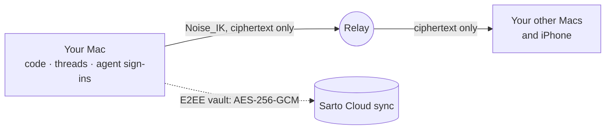

<div align="center">


<h1>Sarto — Native macOS Multi-Agent ADE</h1>

**One pure SwiftUI & Metal Agentic Development Environment (ADE) for Claude Code, OpenAI Codex, Gemini CLI, Cursor, OpenCode, Cline and 40+ ACP coding agents — with a built-in pixel idle RPG.**

Replace scattered terminal tabs and heavy Electron forks with a private, native macOS workspace: parallel Git worktrees, MacBook notch Dynamic Island approvals, menu bar quota monitoring, Remote Claude Code, and idle RPG progression while you ship.

[](#sarto-ade-vs-other-ai-coding-setups)
[](#native-macos-experience-dynamic-island-quotas-and-prism)
[](#install)
[](#multi-agent-orchestration-and-acp-client)
[](#coding-idle-rpg-grind-while-you-code)
[](../../PRIVACY.md)
[](../../LICENSE)

[Download](https://sarto.1o.ink/releases/latest) · [Comparison](#sarto-ade-vs-other-ai-coding-setups) · [46 Agents](#multi-agent-orchestration-and-acp-client) · [Idle RPG](#coding-idle-rpg-grind-while-you-code) · [FAQ](#faq) · [Security](../../SECURITY.md) · [简体中文](./README-C-seo-growth.zh-CN.md)

</div>

> [!NOTE]
> Sarto (_tailor_ in Italian) is in active early development: v0.3.2 for macOS 15+ on Apple silicon.

## Sarto ADE vs. other AI coding setups

| Capability                         | Electron AI IDE Forks       | Raw Terminal CLIs           | Sarto — Native macOS ADE                                                  |
| ---------------------------------- | --------------------------- | --------------------------- | ------------------------------------------------------------------------- |
| **Runtime & battery**              | Chromium / Electron         | Lightweight, text-only      | **Pure Swift 6, SwiftUI, AppKit & Metal** (Low Power & thermal aware)     |
| **Supported coding agents**        | Locked to 1 built-in vendor | 1 CLI per terminal tab      | **46 agents in one GUI** (6 native SDK/RPC drivers + 40 ACP agents)       |
| **Subscriptions & API keys**       | Extra seat / token markup   | Your own CLI accounts       | **100% your own CLI installs, subscriptions & API keys**                  |
| **Parallel multi-agent workflows** | Manual window juggling      | Manual `git worktree` setup | **Built-in Git worktrees, mid-session agent handoff & file rewind**       |
| **macOS notch & menu bar**         | None                        | None                        | **Notch Dynamic Island approvals + liquid menu bar quota & spend charts** |
| **Waiting on long agent runs**     | Stare at a spinner          | Watch scrolling logs        | **Built-in pixel Agent Idle RPG — battle through to-dos while coding**    |
| **Cross-Mac & mobile execution**   | Single machine or cloud VM  | Manual SSH / tmux           | **Remote Claude Code + E2EE Multi-Mac sidebar + iPhone approvals**        |
| **Privacy & telemetry**            | Cloud telemetry common      | Depends on CLI              | **Zero telemetry, local-first, `Noise_IK` + `AES-256-GCM` E2EE**          |

## Multi-agent orchestration and ACP client

Sarto implements no agent of its own — it is a unified **desktop GUI and orchestrator** for the coding agents you already trust:

- **Native SDK, Server & RPC drivers (6)**: **Claude Code**, **OpenAI Codex**, **OpenCode**, **Pi**, **DeepSeek Harness** and **Cline** (with automatic ACP fallback for OpenCode and Cline).
- **Agent Client Protocol — ACP (40)**: first-class client for **Google Antigravity** (context breakdown, per-request telemetry, plan mode, subagents, steering, question forms, plugins and plan limits), **Gemini CLI**, **Cursor**, **GitHub Copilot**, **Qwen Code**, **Kimi Code**, **Grok**, **Amp**, **goose**, **Devin**, **Factory Droid**, **Mistral Vibe**, **Junie**, **Auggie CLI** and 26 more.
- **Lifecycle, handoff & history**: checks prerequisites, guides CLI installs/updates, configures permission modes, imports past CLI sessions, and **hands an active session from one agent to another** between turns with context preserved or summarized.
- **Vendor quota & token spend tracking**: reads live plan quotas and balances from signed-in vendors and calculates local token spend at API list prices.

## Coding idle RPG: grind while you code

> [!NOTE]
> In development: game mechanics, balance and pixel art are actively evolving.

Sarto is an **ADE with a built-in idle game** designed for multi-agent workflows:

- **Pixel Co-Op Todo Battles**: when an agent executes a plan, Sarto and your agent fight together in the collapsible right rail. Real coding turns trigger shots and auto-skills, and each completed step deals a finishing strike.
- **Agent RPG character sheets**: every agent earns experience, rank tiers, power score (`PWR`), `DPS`, weapons, gear, medals and commander bond levels while shipping your code.
- **Zero distraction, zero code leakage**: four motion tiers step from **Arcade** down to **Calm**, **Still** or **Off** for battery life, and progression uses only opaque timing/step counts — never your code or prompts.

## Full agentic workbench: Composer, Git worktrees, Terminal & Preview

- **Two-tier floating Composer**: agent/model pickers, pinned models, model-accurate reasoning effort, permission modes, project & **Git worktree** pickers, `@` file/folder/session mentions, `/` slash commands, attachments, `↑`/`↓` history, and live context-window, prompt-cache and tok/s popovers.
- **Rewind, fork & steer**: steer a running turn, queue follow-ups, comment inline on reply passages, edit a sent message to **rewind both the conversation and its file changes**, or fork from any turn (with prompt-cache expiry warnings).
- **Git & GitHub workflow**: unified `HEAD` diffs with per-file staging, worktree-isolated parallel agents, AI-drafted commits and PRs, and a next-step assistant for merge conflicts, failed CI checks and reviews.
- **Editor, PTY terminals & live preview**: conflict-detecting file editor, take-over PTY terminals (automatically pausing agents on password prompts), plus an agent-drivable **built-in web browser, iOS simulator and Android emulator/device** pane.
- **MCP Hub, plugins & shared memory**: Keychain-encrypted MCP servers with OAuth and inline elicitation forms, plugin marketplaces (Claude Code, Codex, Antigravity), and global/project memory shared across all 46 agents.

## Native macOS experience: Dynamic Island, quotas and Prism

- **MacBook notch Dynamic Island**: concave-shoulder island on one or multiple displays showing live plan progress, session stacks, nine-dot activity and cross-Mac permission/question approvals.
- **Menu bar usage panel**: liquid quota tubes, plan rings, today's model leaderboard and 7/30/90-day stacked usage charts. Closing windows leaves agents running in the menu bar; `⌘Q` requires a double press.
- **Prism Metal visual system**: four Metal-drawn optical palettes (`Obsidian Dark`, `Warm Charcoal`, `Daylight Crystal`, `Warm Alabaster`) with runtime-switching Dock icons, HSB accent wheel, scannable timeline rails, Mermaid/SVG/math rendering, and full English & Simplified Chinese localization.
- **Signed delta updates & headless CLI**: Ed25519 + Apple code-signed updates keep running sessions alive; `sarto` CLI runs headless on remote Macs.

## Remote Claude Code, Multi-Mac & zero-trust privacy

- **Remote Claude Code**: run Claude Code's model on another signed-in Mac of your account while files, shell commands and permissions stay local, over an end-to-end encrypted channel.
- **Multi-Mac sidebar & iPhone app**: connect all your Macs via 8-character `XXXX-XXXX` commit-then-reveal pairing (or 128-bit recovery key) and approve tasks on **Sarto for iPhone** (iPhone Duo foldable-ready, coming soon to the App Store).
- **Verifiable security**: source code and agent sign-ins never touch Sarto Cloud. Device relays use `Noise_IK_25519_AESGCM_SHA256` (padded ciphertext only), sync uses `AES-256-GCM`, protocols are open in [`packages/sarto-wire`](../../packages/sarto-wire/PROTOCOL.md), and releases ship from [GitHub Actions](../../.github/workflows/release-mac.yml) with SLSA provenance. Details in [SECURITY.md](../../SECURITY.md) and [PRIVACY.md](../../PRIVACY.md).



## Tailored from the best

Sarto builds natively on open ideas from [Kettu](https://github.com/KettuAI/Kettu) (daemon architecture, rebuilt without Electron), [Cindy](https://github.com/makecindy/cindy) (menu bar usage panel & timeline rail), [Obsidian Prism](https://github.com/RMvdesi/obsidian-prism) (palettes & motion), and [Code Island](https://github.com/wxtsky/CodeIsland) (notch silhouette). Full licenses in [THIRD_PARTY_NOTICES.md](../../THIRD_PARTY_NOTICES.md).

## Install

1. **Mac app** (macOS 15+, Apple silicon): download `Sarto-<version>-arm64.dmg` from [`sarto.1o.ink/releases/latest`](https://sarto.1o.ink/releases/latest) and drag Sarto to Applications.
2. **Standalone daemon**:
   ```sh
   curl -fsSL https://sarto.1o.ink/releases/latest/download/install.sh | sh
   ```
3. **Build from source** (Xcode 16+, Node.js 22.13+, pnpm 10 — [CONTRIBUTING.md](../../CONTRIBUTING.md)):
   ```sh
   pnpm install && pnpm build:daemon && open apps/apple/Sarto.xcodeproj
   ```

## Supported agents (all 46)

<details>
<summary><b>View all 46 supported coding agents</b></summary>

|                                                                     |                                                                                     |                                                          |                                                                             |
| ------------------------------------------------------------------- | ----------------------------------------------------------------------------------- | -------------------------------------------------------- | --------------------------------------------------------------------------- |
| [Claude Code](https://github.com/anthropics/claude-code)            | [Codex](https://github.com/openai/codex)                                            | [OpenCode](https://opencode.ai)                          | [Pi](https://pi.dev)                                                        |
| [DeepSeek Harness](https://github.com/deepseek-ai/deepseek-harness) | [Cline](https://cline.bot/cli)                                                      | [Google Antigravity](https://antigravity.google)         | [Gemini CLI](https://github.com/google-gemini/gemini-cli)                   |
| [Cursor](https://cursor.com/docs/cli/acp)                           | [GitHub Copilot](https://github.com/github/copilot-cli)                             | [Qwen Code](https://github.com/QwenLM/qwen-code)         | [Kimi Code](https://github.com/MoonshotAI/kimi-code)                        |
| [Grok](https://x.ai/cli)                                            | [Amp](https://ampcode.com)                                                          | [goose](https://block.github.io/goose/)                  | [Kilo Code](https://kilo.ai)                                                |
| [Factory Droid](https://factory.ai/product/cli)                     | [OMP (Oh My Pi)](https://omp.sh)                                                    | [Hermes Agent](https://hermes-agent.nousresearch.com)    | [Devin](https://docs.devin.ai/cli)                                          |
| [Mistral Vibe](https://github.com/mistralai/mistral-vibe)           | [Junie](https://junie.jetbrains.com)                                                | [Auggie CLI](https://github.com/augmentcode/auggie)      | [VT Code](https://github.com/vinhnx/VTCode)                                 |
| [Qoder CLI](https://qoder.com)                                      | [Qoder CN](https://qoder.cn)                                                        | [Codebuddy Code](https://www.codebuddy.cn/cli/)          | [DeepAgents](https://docs.langchain.com/oss/javascript/deepagents/overview) |
| [DimCode](https://dimagent.cn/)                                     | [Dirac](https://dirac.run)                                                          | [GLM Agent](https://github.com/stefandevo/glm-acp-agent) | [Nova](https://www.compassap.ai/portfolio/nova.html)                        |
| [siGit Code](https://github.com/getsigit/sigit)                     | [Agoragentic](https://agoragentic.com)                                              | [Autohand Code](https://www.autohand.ai/cli/)            | [Muse Code](https://dev.meta.ai)                                            |
| [CodeWhale](https://codewhale.net)                                  | [Bob](https://bob.ibm.com)                                                          | [MiniMax Code](https://agent.minimax.io)                 | [Harn](https://harnlang.com)                                                |
| [Kimchi](https://kimchi.dev)                                        | [Cortex Code](https://docs.snowflake.com/en/user-guide/cortex-code/cortex-code-cli) | [Corust Agent](https://corust.ai)                        | [crow-cli](https://github.com/crow-cli/crow-cli)                            |
| [Poolside](https://poolside.ai)                                     | [Stakpak](https://stakpak.dev)                                                      |                                                          |                                                                             |

</details>

## FAQ

<details>
<summary><b>What is an ADE (Agentic Development Environment)?</b></summary>

While an IDE centers on manually editing single files, an **ADE** centers on orchestrating one or many autonomous coding agents in parallel — combining threads, plan approvals, Git worktree isolation, unified diff review, terminals, live app previews and quota monitoring in a single workspace.

</details>

<details>
<summary><b>Does Sarto require a new AI subscription or API markup?</b></summary>

No. Sarto drives the CLI agents and logins already installed on your Mac (such as your Claude Max/Pro login, ChatGPT/Codex account, Gemini CLI login or your own API keys) with zero token markup, and an account is optional.

</details>

<details>
<summary><b>Does the built-in idle RPG upload my code or prompts?</b></summary>

Never. Source code, prompts, conversation threads and file paths never leave your Mac. Idle RPG progression uses only minimal opaque timing and step facts, and can be dimmed or turned off completely.

</details>

## Topics

`ade` · `agentic-development-environment` · `agent-development-environment` · `claude-code` · `claude-code-gui` · `codex` · `codex-gui` · `gemini-cli` · `cursor` · `github-copilot` · `opencode` · `cline` · `antigravity` · `agent-client-protocol` · `acp` · `model-context-protocol` · `mcp` · `multi-agent` · `coding-agents` · `ai-coding` · `vibe-coding` · `idle-game` · `idle-rpg` · `gamified-coding` · `macos` · `swiftui` · `metal` · `git-worktree` · `dynamic-island` · `end-to-end-encryption`

## Feedback & License

Open an [issue](https://github.com/Rladmsrl/Sarto/issues/new/choose) in any language; report security issues privately per [SECURITY.md](../../SECURITY.md). Licensed under [AGPL-3.0](../../LICENSE) ([`packages/sarto-wire`](../../packages/sarto-wire) is Apache-2.0). Independent project, unaffiliated with Anthropic, OpenAI, Google, Apple or any agent maker.
