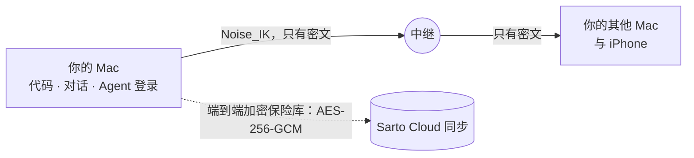

<div align="center">


<h1>Sarto —— 原生 macOS 多 Agent 智能体开发环境（ADE）</h1>

**一个纯正 SwiftUI + Metal 桌面工作台，统一编排 Claude Code、OpenAI Codex、Gemini CLI、Cursor、OpenCode、Cline 等 46 个编程 Agent——内置像素挂机 RPG，边 Coding 边挂机。**

告别散乱的十几个终端标签页与吃内存的 Electron 套壳：Git Worktree 并行隔离、MacBook 刘海灵动岛审批、菜单栏额度监控、远程 Claude Code，在等待代码交付的同时自动闯关刷装备。

[](#sarto-ade-与其他开发方式对比)
[](#原生-macos-体验灵动岛额度栏与-prism)
[](#安装)
[](#多-agent-编排与-acp-客户端)
[](#编程挂机-rpg边-coding-边挂机)
[](../../PRIVACY.zh-CN.md)
[](../../LICENSE)

[下载](https://sarto.1o.ink/releases/latest) · [横向对比](#sarto-ade-与其他开发方式对比) · [46 个 Agent](#多-agent-编排与-acp-客户端) · [边 Coding 边挂机](#编程挂机-rpg边-coding-边挂机) · [常见问题](#常见问题) · [安全](../../SECURITY.zh-CN.md) · [English](./README-C-seo-growth.md)

</div>

> [!NOTE]
> Sarto（意大利语「裁缝」）处于早期快速迭代中：当前版本 v0.3.2，支持 Apple 芯片、macOS 15 及以上。

## Sarto ADE 与其他开发方式对比

| 核心维度               | Electron 套壳 AI IDE     | 纯终端 CLI 命令行   | Sarto —— 原生 macOS ADE                                        |
| ---------------------- | ------------------------ | ------------------- | -------------------------------------------------------------- |
| **底层架构与续航**     | Chromium / Electron 进程 | 轻量，但仅纯文本    | **纯 Swift 6、SwiftUI、AppKit 与 Metal**（感知低电量与发热）   |
| **支持的编程 Agent**   | 通常绑定单一自家服务     | 每个终端窗口各跑 1  | **一个图形界面驱动 46 个 Agent**（6 原生驱动 + 40 ACP）        |
| **账号与订阅费用**     | 需额外购买平台席位/加价  | 用你自己的 CLI 账号 | **100% 复用本机已装 CLI、官方订阅与自有 API Key，零加价**      |
| **多 Agent 并行协作**  | 手动多开窗口来回切       | 手动管理 Worktree   | **内置 Git Worktree 隔离、会话中途换 Agent、消息连同文件回退** |
| **macOS 刘海与菜单栏** | 无                       | 无                  | **刘海凹肩灵动岛跨机审批 + 菜单栏液态额度柱与花费统计**        |
| **长任务等待体验**     | 干等转圈动画             | 盯着滚动日志发呆    | **内置像素风 Agent 挂机 RPG——边写代码边打穿 Todo 爆装备**      |
| **跨设备与远程算力**   | 仅单机或依赖云端虚拟机   | 手工配 SSH / tmux   | **远程 Claude Code + 端到端加密多 Mac 侧栏 + iPhone 审批**     |
| **代码隐私与遥测**     | 普遍含云端遥测上报       | 取决于各家 CLI      | **零遥测、代码永不离机，`Noise_IK` + `AES-256-GCM` 加密**      |

## 多 Agent 编排与 ACP 客户端

Sarto 自身不捆绑任何封闭 Agent，而是为你信赖的所有编程 Agent 提供统一的 **原生桌面 GUI 与调度中心**：

- **6 个专用原生驱动（SDK / Server / RPC）**：**Claude Code**、**OpenAI Codex**、**OpenCode**、**Pi**、**DeepSeek Harness** 与 **Cline**（OpenCode 与 Cline 可自动回退至 ACP）。
- **40 个 ACP（Agent Client Protocol）Agent**：原生深度适配 **Google Antigravity**（上下文明细、逐请求遥测、计划模式、子 Agent、插话引导、提问表单、插件与额度），并支持 **Gemini CLI**、**Cursor**、**GitHub Copilot**、**Qwen Code**、**Kimi Code**、**Grok**、**Amp**、**goose**、**Devin**、**Factory Droid**、**Mistral Vibe**、**Junie**、**Auggie CLI** 等共 46 款工具。
- **全生命周期、接力与历史导入**：自动检测依赖、引导安装更新、配置默认权限模式、导入已有 CLI 历史会话，并支持**在两轮对话之间把会话无缝移交给另一个 Agent**（保留或摘要上下文）。
- **厂商套餐额度与花费追踪**：实时读取已登录 Agent 的官方剩余额度与余额，并按 API 标价从本地日志统计 Token 与开销。

## 编程挂机 RPG：边 Coding 边挂机

> [!NOTE]
> 开发中：玩法机制、数值平衡与像素美术仍在持续演进。

Sarto 是一款**自带挂机游戏的 ADE**，把多 Agent 跑任务时的等待空档转化为轻松的养成乐趣：

- **像素风协作 Todo 战斗**：当 Agent 按计划执行任务时，Sarto 与该 Agent 会在右侧折叠栏组队开战——真实编码回合持续触发攻击与自动技能，每完成一步计划就轰出一记终结伤害。
- **Agent 专属角色卡**：每个编程 Agent 都能积累经验、晋升段位，养成战力（`PWR`）、秒伤（`DPS`）、武器装备、勋章与指挥官羁绊等级。
- **不抢注意力、不传一行代码**：提供 **街机 → 安静 → 静止 → 关闭** 四级能耗档位；游戏进度仅依赖脱敏的耗时与步骤数，源码与 Prompt 永不离机。

## 完整 ADE 工作台：输入框、Git Worktree、终端与预览

- **双层悬浮输入框**：Agent/模型切换、置顶模型、按模型真实能力匹配的思考深度、权限模式、项目与 **Git Worktree** 选择、`@` 引用文件/目录/会话、`/` 命令、附件、`↑`/`↓` 历史，以及上下文窗口、提示缓存与输出速度实时浮窗。
- **插话、回退与分叉**：运行中插话引导或排队后续指令，对回复段落写内联评论；编辑已发消息可**将对话与文件改动一并回退**，或从任意节点分叉新会话（提示缓存即将过期时会提前预警）。
- **Git 与 GitHub 闭环**：相对 `HEAD` 的统一 Diff 与按文件勾选提交、Worktree 隔离并行会话、AI 起草 Commit 与 PR，以及冲突、CI 失败、Review 与合并的下一步面板。
- **文件编辑、PTY 终端与多端预览**：带保存冲突检测的文件编辑器，可随时接管再交还的 PTY 终端（遇密码输入自动暂停 Agent），并排内置 **Agent 可操控的浏览器、iOS 模拟器与 Android 模拟器/真机**。
- **MCP Hub、插件与共享记忆**：钥匙串加密的 MCP 服务器（支持 OAuth 与内联表单）、插件市场管理（Claude Code / Codex / Antigravity），以及跨 46 个 Agent 共享的全局与项目记忆。

## 原生 macOS 体验：灵动岛、额度栏与 Prism

- **MacBook 刘海灵动岛**：凹肩贴合刘海或任意指定屏幕，实时展示计划进度、会话堆叠与九点活动指示，跨 Mac 直接审批权限与计划。
- **菜单栏液态用量面板**：液态额度柱、套餐圆环、今日模型排行与 7/30/90 天堆叠用量图；关窗后后台常驻运行，`⌘Q` 连按两次防误退。
- **Prism Metal 视觉系统**：四套 Metal 光学主题（`Obsidian Dark`、`Warm Charcoal`、`Daylight Crystal`、`Warm Alabaster`）与实时切换的配套 Dock 图标，可折叠工具时间轴，原生渲染 Mermaid / SVG / 数学公式，完整中英双语界面。
- **签名增量更新与独立 CLI**：Ed25519 + Apple 代码签名更新不断会话；提供无界面 `sarto` CLI。

## 远程 Claude Code、跨设备协同与零信任隐私

- **远程 Claude Code**：让 Claude Code 模型跑在你账号下另一台已登录的 Mac 上，文件、Shell 命令与权限留在当前这台 Mac，全程走端到端加密通道。
- **多 Mac 同侧栏 + iPhone 应用**：通过 8 位 `XXXX-XXXX` 核对码（或 128-bit 恢复密钥）配对所有受信任 Mac，并支持 **Sarto for iPhone**（适配 iPhone Duo 折叠屏，即将上架 App Store）移动端加密推送与审批。
- **人人可验证的隐私安全**：代码与登录态从不进入 Sarto Cloud；中继仅转发 `Noise_IK` 填充密文，同步采用 `AES-256-GCM`，协议完全公开于 [`packages/sarto-wire`](../../packages/sarto-wire/PROTOCOL.md)，发布版由 [GitHub Actions](../../.github/workflows/release-mac.yml) 构建并附 SLSA 溯源证明。详见 [SECURITY.zh-CN.md](../../SECURITY.zh-CN.md) 与 [PRIVACY.zh-CN.md](../../PRIVACY.zh-CN.md)。



## 博采众长

Sarto 原生吸收并致敬了 [Kettu](https://github.com/KettuAI/Kettu)（daemon 多进程架构，去掉 Electron 重构）、[Cindy](https://github.com/makecindy/cindy)（菜单栏用量面板与时间轴）、[Obsidian Prism](https://github.com/RMvdesi/obsidian-prism)（调色板与动效）与 [Code Island](https://github.com/wxtsky/CodeIsland)（灵动岛轮廓）。完整许可见 [THIRD_PARTY_NOTICES.md](../../THIRD_PARTY_NOTICES.md)。

## 安装

1. **Mac 桌面应用**（macOS 15+、Apple 芯片）：从 [`sarto.1o.ink/releases/latest`](https://sarto.1o.ink/releases/latest) 下载 `Sarto-<版本>-arm64.dmg`，拖入「应用程序」。
2. **独立无界面 daemon**：
   ```sh
   curl -fsSL https://sarto.1o.ink/releases/latest/download/install.sh | sh
   ```
3. **从源码构建**（Xcode 16+、Node.js 22.13+、pnpm 10 —— [CONTRIBUTING.md](../../CONTRIBUTING.md)）：
   ```sh
   pnpm install && pnpm build:daemon && open apps/apple/Sarto.xcodeproj
   ```

## 支持的 Agent（全部 46 个）

<details>
<summary><b>展开查看全部 46 个编程 Agent</b></summary>

|                                                                     |                                                                                     |                                                          |                                                                             |
| ------------------------------------------------------------------- | ----------------------------------------------------------------------------------- | -------------------------------------------------------- | --------------------------------------------------------------------------- |
| [Claude Code](https://github.com/anthropics/claude-code)            | [Codex](https://github.com/openai/codex)                                            | [OpenCode](https://opencode.ai)                          | [Pi](https://pi.dev)                                                        |
| [DeepSeek Harness](https://github.com/deepseek-ai/deepseek-harness) | [Cline](https://cline.bot/cli)                                                      | [Google Antigravity](https://antigravity.google)         | [Gemini CLI](https://github.com/google-gemini/gemini-cli)                   |
| [Cursor](https://cursor.com/docs/cli/acp)                           | [GitHub Copilot](https://github.com/github/copilot-cli)                             | [Qwen Code](https://github.com/QwenLM/qwen-code)         | [Kimi Code](https://github.com/MoonshotAI/kimi-code)                        |
| [Grok](https://x.ai/cli)                                            | [Amp](https://ampcode.com)                                                          | [goose](https://block.github.io/goose/)                  | [Kilo Code](https://kilo.ai)                                                |
| [Factory Droid](https://factory.ai/product/cli)                     | [OMP (Oh My Pi)](https://omp.sh)                                                    | [Hermes Agent](https://hermes-agent.nousresearch.com)    | [Devin](https://docs.devin.ai/cli)                                          |
| [Mistral Vibe](https://github.com/mistralai/mistral-vibe)           | [Junie](https://junie.jetbrains.com)                                                | [Auggie CLI](https://github.com/augmentcode/auggie)      | [VT Code](https://github.com/vinhnx/VTCode)                                 |
| [Qoder CLI](https://qoder.com)                                      | [Qoder CN](https://qoder.cn)                                                        | [Codebuddy Code](https://www.codebuddy.cn/cli/)          | [DeepAgents](https://docs.langchain.com/oss/javascript/deepagents/overview) |
| [DimCode](https://dimagent.cn/)                                     | [Dirac](https://dirac.run)                                                          | [GLM Agent](https://github.com/stefandevo/glm-acp-agent) | [Nova](https://www.compassap.ai/portfolio/nova.html)                        |
| [siGit Code](https://github.com/getsigit/sigit)                     | [Agoragentic](https://agoragentic.com)                                              | [Autohand Code](https://www.autohand.ai/cli/)            | [Muse Code](https://dev.meta.ai)                                            |
| [CodeWhale](https://codewhale.net)                                  | [Bob](https://bob.ibm.com)                                                          | [MiniMax Code](https://agent.minimax.io)                 | [Harn](https://harnlang.com)                                                |
| [Kimchi](https://kimchi.dev)                                        | [Cortex Code](https://docs.snowflake.com/en/user-guide/cortex-code/cortex-code-cli) | [Corust Agent](https://corust.ai)                        | [crow-cli](https://github.com/crow-cli/crow-cli)                            |
| [Poolside](https://poolside.ai)                                     | [Stakpak](https://stakpak.dev)                                                      |                                                          |                                                                             |

</details>

## 常见问题

<details>
<summary><b>什么是 ADE（智能体开发环境，Agentic Development Environment）？</b></summary>

传统 IDE 围绕「人手写单个代码文件」构建；而 **ADE** 围绕「同时指挥一个或多个自主编程 Agent」构建——把多会话编排、计划与权限审批、Git Worktree 分支隔离、统一 Diff 审阅、PTY 终端、浏览器/模拟器实时预览以及额度监控整合进同一个原生工作台。

</details>

<details>
<summary><b>使用 Sarto 需要额外买会员或按 Token 加价付费吗？</b></summary>

不需要。Sarto 直接驱动你本机已安装并登录的 Agent（例如你自己的 Claude Pro/Max、ChatGPT/Codex 订阅、Gemini CLI 账号或自有 API Key），零中间差价，连 Sarto 账号本身都是可选的。

</details>

<details>
<summary><b>「边 Coding 边挂机」的内置 RPG 会把我的代码或 Prompt 传上云端吗？</b></summary>

绝不会。源代码、Prompt、对话记录与文件路径永远留在你的本机；挂机游戏仅依据脱敏的耗时与步骤计数结算，且随时可以调为静止或彻底关闭。

</details>

## 搜索标签

`ade` · `agentic-development-environment` · `agent-development-environment` · `智能体开发环境` · `Agent 开发环境` · `Claude Code 客户端` · `Claude Code GUI` · `Codex 桌面端` · `Gemini CLI` · `Cursor` · `GitHub Copilot` · `OpenCode` · `Cline` · `Antigravity` · `ACP 协议` · `MCP` · `多 Agent 协同` · `多智能体并行开发` · `Vibe Coding` · `边 coding 边挂机` · `边写代码边挂机` · `编程挂机游戏` · `内置挂机 RPG` · `原生 macOS` · `SwiftUI` · `Metal` · `Git Worktree` · `Mac 灵动岛` · `AI 额度监控` · `端到端加密`

## 反馈与许可证

欢迎用任何语言提交 [Issue](https://github.com/Rladmsrl/Sarto/issues/new/choose)；安全问题请按 [SECURITY.zh-CN.md](../../SECURITY.zh-CN.md) 私密上报。采用 [AGPL-3.0](../../LICENSE) 开源（[`packages/sarto-wire`](../../packages/sarto-wire) 为 Apache-2.0）。Sarto 为独立项目，与 Anthropic、OpenAI、Google、Apple 及任何 Agent 开发方均无关联。
