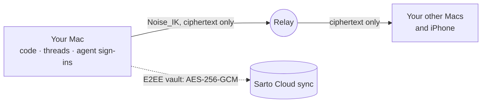

<div align="center">


<h1>Sarto</h1>

**The native, beautiful, private macOS ADE — orchestrate 46 coding agents in parallel and grind an idle RPG while you ship.**

_Sarto_ is Italian for _tailor_: a pure SwiftUI and Metal **Agentic Development Environment (ADE)** that stitches Claude Code, Codex, Gemini CLI, Git worktrees, a notch Dynamic Island and a pixel idle game into one workspace.

[](#why-sarto-ade)
[](#native-to-the-mac-and-beautiful-by-craft)
[](#install)
[](#supported-agents)
[](#code-while-you-idle-the-agent-rpg)
[](../../PRIVACY.md)
[](https://sarto.1o.ink/releases/latest)
[](../../LICENSE)

[Download](https://sarto.1o.ink/releases/latest) · [Why an ADE](#why-sarto-ade) · [Idle RPG](#code-while-you-idle-the-agent-rpg) · [Supported Agents](#supported-agents) · [FAQ](#faq) · [Security](../../SECURITY.md) · [Privacy](../../PRIVACY.md) · [简体中文](./README-E-recommended-hybrid.zh-CN.md)

</div>

> [!NOTE]
> Sarto is in early, active development: v0.3.2 for macOS 15 or later on Apple silicon.

## Why Sarto ADE

IDEs were built for typing one file by hand; terminal tabs weren't built for reviewing diffs, previewing apps or approving five agents at once. **Sarto is a native Agentic Development Environment (ADE)** — built for directing parallel coding agents and enjoying the minutes while they think:

|                            | Electron AI IDEs     | Terminal CLIs       | Sarto — Native macOS ADE                                              |
| -------------------------- | -------------------- | ------------------- | --------------------------------------------------------------------- |
| **Runtime**                | Chromium / Electron  | Terminal only       | **Pure Swift 6, SwiftUI, AppKit & Metal** (zero Swift dependencies)   |
| **Agents & accounts**      | 1 vendor, extra seat | 1 CLI per tab       | **46 agents in one GUI**, using your own CLI installs & subscriptions |
| **Parallelism & Git**      | Manual windows       | Manual worktrees    | **Git worktrees, mid-session agent handoff, unified diffs & rewind**  |
| **macOS exclusives**       | None                 | None                | **Notch Dynamic Island approvals + liquid menu bar quota panel**      |
| **Waiting on long runs**   | Spinner              | Scrolling logs      | **Built-in pixel Agent Idle RPG — fight through to-dos while coding** |
| **Multi-device & privacy** | Cloud telemetry      | Local or manual SSH | **Remote Claude Code + Multi-Mac & iPhone over `Noise_IK` E2EE**      |

## Highlights

<table>
<tr>
<td width="33%" valign="top">

**Beautiful**<br/>
Four Metal-lit optical palettes, matching runtime Dock icons, restrained motion and a Dynamic Island that grows out of the notch.

</td>
<td width="33%" valign="top">

**Native macOS ADE**<br/>
SwiftUI, AppKit and Metal with zero Electron. Menu bar quotas, `⌘` shortcuts, Low Power Mode and thermal aware.

</td>
<td width="33%" valign="top">

**46 agents, one interface**<br/>
Claude Code, Codex, Gemini CLI, Cursor, Copilot, Antigravity, OpenCode, Cline and 38 more — with your own accounts.

</td>
</tr>
<tr>
<td valign="top">

**Code while you idle**<br/>
A pixel Co-Op Todo Battle and idle RPG in the side rail: your agents deal damage, earn gear and level up as they ship code. _In development._

</td>
<td valign="top">

**Remote Claude Code**<br/>
Run Claude Code's model on another of your Macs while files, commands and permissions stay on this one.

</td>
<td valign="top">

**Tailored from the best**<br/>
Proven ideas from Kettu, Cindy, Obsidian Prism and Code Island, stitched natively into one private ADE.

</td>
</tr>
</table>

## Every agent, one multi-agent workbench

- **6 native drivers and 40 ACP agents**: dedicated SDK, server and RPC drivers for **Claude Code**, **Codex**, **OpenCode**, **Pi**, **DeepSeek Harness** and **Cline** (OpenCode and Cline fall back to ACP), and the Agent Client Protocol for 40 more, including **Google Antigravity**, **Gemini CLI**, **Cursor**, **GitHub Copilot**, **Qwen Code** and **Kimi Code**. Sarto implements no agent: it drives your own installs, accounts and configurations.
- **Deep Antigravity support**: its context breakdown, per-request telemetry, plan mode, subagents, steering, question forms, plugins and plan limits.
- **Harness lifecycle**: checks prerequisites, guides installation and updates, and sets each agent's binary and start mode, plus the default permission mode for Claude Code, Codex, DeepSeek Harness and Antigravity.
- **Switch agents mid-session**: hand a session to another agent between turns with its context carried over, optionally summarized first.
- **Bring your history**: import sessions you started in Claude Code, Codex, Pi or any ACP agent that lists its sessions.
- **Plan quotas at a glance**: reads each signed-in agent's plan limits and balance from its vendor, and tracks tokens and spend from local logs at API list prices.

## Code while you idle: the Agent RPG

> [!NOTE]
> In development: the game, its balance and its art are still changing.

Multi-agent coding comes with natural pauses while models reason, run tests and execute plans. Sarto turns those background runs into a zero-distraction **Agent Idle RPG** inside the collapsible right rail:

- **Pixel Co-Op Todo Battles**: when a session has a plan, Sarto and your agent team up on a pixel battle arena — active coding turns fire attacks and auto-skills, and every completed step lands a finishing hit.
- **Per-agent RPG sheets**: each agent builds its own rank tier, power score (`PWR`), `DPS`, weapons, gear loadouts, medals and commander bond levels through real coding work rather than idle clicking.
- **Calm, battery-friendly motion**: steps smoothly from **Arcade** (weapons, skills and damage popups) down to **Calm**, **Still** or **Off**, automatically throttling for still windows, Low Power Mode and thermal pressure.
- **Private while playing**: progression uses only minimal opaque timing and step facts — source code, prompts and file paths never leave your Mac.

## A workspace around the conversation

- **Composer**: a two-tier floating composer with agent and model pickers, pinned models, a model-accurate effort selector, permission modes, project and Git worktree pickers, `@` mentions of files, folders and sessions, `/` commands, images and attachments, `↑`/`↓` prompt history, and live popovers for the context window, prompt cache and output speed.
- **Flow control**: queue follow-ups or steer a running turn. Where the agent supports it, edit a sent message to rewind the conversation and its files, put it back if you change your mind, or fork a new session from any reply, with a warning when the prompt cache would expire.
- **Inline comments**: comment on passages of a reply and send them with your next message.
- **Session Board and subagents**: background commands, monitors and subagents with live progress, inline subagent cards and linked navigation.
- **Find anything**: `⌘K` searches every session on every connected Mac, `⌘F` finds within a session, and the outline popover, timeline rail and per-session reading position keep long threads navigable. Export any session as Markdown.
- **Git**: diffs against `HEAD` with per-file commit selection, branch and worktree-isolated sessions, AI-drafted commit messages and pull requests, and a next-step panel for conflicts, failed checks, reviews, publishing and merging on GitHub.
- **Files and terminals**: a project file tree with an editor that detects conflicting saves and restores drafts, and PTY terminals you can take over from an agent and hand back. Sarto pauses agent input when a terminal asks for a password.
- **Preview**: a built-in web browser agents can inspect and drive (and you can take over), iOS simulators, and Android emulators and devices, side by side.

## Native to the Mac, and beautiful by craft

- **Dynamic Island**: a concave-shoulder island under the MacBook notch or atop any display, on one or several screens you pick on a display map. It shows live plan progress and lets you answer permissions, questions and plans from any of your Macs, with a stack of sessions, a usage tab and a nine-dot activity indicator.
- **Menu bar usage panel**: liquid quota tubes, plan rings, a live session banner, today's model ranking and 7, 30 and 90-day stacked usage charts across your agents and Macs. Closing the windows keeps Sarto and your agents running in the menu bar; `⌘Q` asks twice before closing the windows.
- **Prism visual system**: four optical palettes (`Obsidian Dark`, `Warm Charcoal`, `Daylight Crystal`, `Warm Alabaster`) drawn with Metal, each with a matching runtime Dock icon, HSB accent wheel, expandable tool timeline rails, syntax-highlighted code folding, GFM/SVG/Mermaid/math, and full English & Simplified Chinese UI.
- **Signed self-updates & standalone daemon**: Ed25519 + Apple code-signed delta updates keep running sessions alive; `sarto` CLI runs headless on remote Macs.

## Remote Claude Code, Multi-Mac, and iPhone

- **Remote Claude Code**: start a session on this Mac and let Claude Code's **model run on another Mac of your account** while files, shell commands, permissions and Sarto's tools stay local, with host-controlled concurrency limits and idle reclamation.
- **One sidebar for all your Macs**: live connection states, cross-Mac search, island approvals, and remote files, Git and terminals (closed until enabled on that Mac), paired via 8-character `XXXX-XXXX` commit-then-reveal codes or a 128-bit recovery key.
- **Sarto for iPhone**: native iOS companion app adapted to iPhone Duo's foldable display, with encrypted push notifications and approvals on the go (_beta complete, coming to the App Store soon; not in this repository yet_).

## Private by design, verifiable by anyone

Sarto runs agents that read your code and run shell commands, so **you never have to trust a server with your work**:

- **Your work stays on your Macs.** Source code, project files, conversation history and your agents' own sign-ins never go to Sarto Cloud. Zero telemetry, zero analytics, optional account.
- **End-to-end encrypted, everywhere it leaves.** Device connections use `Noise_IK_25519_AESGCM_SHA256` over a padded-ciphertext relay; settings, MCP secrets, skills, themes, memory and usage sync under a device-only 256-bit key (`HKDF-SHA256`, `AES-256-GCM`); push notifications are sealed to each phone's key.
- **Open source & traceable.** AGPL-3.0 app and daemon, Apache-2.0 wire protocol in [`packages/sarto-wire`](../../packages/sarto-wire/PROTOCOL.md), and public [GitHub Actions](../../.github/workflows/release-mac.yml) builds with SLSA provenance and `SHA256SUMS.txt`. See [SECURITY.md](../../SECURITY.md) and [PRIVACY.md](../../PRIVACY.md).



## Extensions, memory, and tailored roots

- **MCP Hub, plugins & shared memory**: Keychain-encrypted MCP servers with OAuth and inline elicitation, plugin management for Claude Code, Codex and Antigravity, Sarto's own MCP tools, and one global/project memory shared across agents.
- **Tailored from the best**: natively adapts ideas from [Kettu](https://github.com/KettuAI/Kettu) (daemon without Electron), [Cindy](https://github.com/makecindy/cindy) (menu bar usage & timeline rail), [Obsidian Prism](https://github.com/RMvdesi/obsidian-prism) (palettes & motion) and [Code Island](https://github.com/wxtsky/CodeIsland) (notch silhouette). Full notices in [THIRD_PARTY_NOTICES.md](../../THIRD_PARTY_NOTICES.md).

## Install

### The Mac app

Download [`sarto.1o.ink/releases/latest`](https://sarto.1o.ink/releases/latest) (`Sarto-<version>-arm64.dmg`) and drag Sarto to Applications (macOS 15+ on Apple silicon; bundles daemon and Node.js).

### The standalone daemon

```sh
curl -fsSL https://sarto.1o.ink/releases/latest/download/install.sh | sh
```

Installs into `~/.local/share/sarto`, links `~/.local/bin/sarto` and registers launchd (`sh -s -- --no-service` to skip). Then run `sarto login`.

### From source

Requires macOS 15+ on Apple silicon, Xcode 16+, Node.js 22.13+ and pnpm 10 ([CONTRIBUTING.md](../../CONTRIBUTING.md)):

```sh
pnpm install
pnpm build:daemon
open apps/apple/Sarto.xcodeproj
```

## Supported agents

<details>
<summary><b>All 46 agents</b></summary>

|                                                                     |                                                                                     |                                                          |                                                                             |
| ------------------------------------------------------------------- | ----------------------------------------------------------------------------------- | -------------------------------------------------------- | --------------------------------------------------------------------------- |
| [Claude Code](https://github.com/anthropics/claude-code)            | [Codex](https://github.com/openai/codex)                                            | [OpenCode](https://opencode.ai)                          | [Pi](https://pi.dev)                                                        |
| [DeepSeek Harness](https://github.com/deepseek-ai/deepseek-harness) | [Cline](https://cline.bot/cli)                                                      | [Google Antigravity](https://antigravity.google)         | [Gemini CLI](https://github.com/google-gemini/gemini-cli)                   |
| [Cursor](https://cursor.com/docs/cli/acp)                           | [GitHub Copilot](https://github.com/github/copilot-cli)                             | [Qwen Code](https://github.com/QwenLM/qwen-code)         | [Kimi Code](https://github.com/MoonshotAI/kimi-code)                        |
| [Grok](https://x.ai/cli)                                            | [Amp](https://ampcode.com)                                                          | [goose](https://block.github.io/goose/)                  | [Kilo Code](https://kilo.ai)                                                |
| [Factory Droid](https://factory.ai/product/cli)                     | [OMP (Oh My Pi)](https://omp.sh)                                                    | [Hermes Agent](https://hermes-agent.nousresearch.com)    | [Devin](https://docs.devin.ai/cli)                                          |
| [Mistral Vibe](https://github.com/mistralai/mistral-vibe)           | [Junie](https://junie.jetbrains.com)                                                | [Auggie CLI](https://github.com/augmentcode/auggie)      | [VT Code](https://github.com/vinhnx/VTCode)                                 |
| [Qoder CLI](https://qoder.com)                                      | [Qoder CN](https://qoder.cn)                                                        | [Codebuddy Code](https://www.codebuddy.cn/cli/)          | [DeepAgents](https://docs.langchain.com/oss/javascript/deepagents/overview) |
| [DimCode](https://dimagent.cn/)                                     | [Dirac](https://dirac.run)                                                          | [GLM Agent](https://github.com/stefandevo/glm-acp-agent) | [Nova](https://www.compassap.ai/portfolio/nova.html)                        |
| [siGit Code](https://github.com/getsigit/sigit)                     | [Agoragentic](https://agoragentic.com)                                              | [Autohand Code](https://www.autohand.ai/cli/)            | [Muse Code](https://dev.meta.ai)                                            |
| [CodeWhale](https://codewhale.net)                                  | [Bob](https://bob.ibm.com)                                                          | [MiniMax Code](https://agent.minimax.io)                 | [Harn](https://harnlang.com)                                                |
| [Kimchi](https://kimchi.dev)                                        | [Cortex Code](https://docs.snowflake.com/en/user-guide/cortex-code/cortex-code-cli) | [Corust Agent](https://corust.ai)                        | [crow-cli](https://github.com/crow-cli/crow-cli)                            |
| [Poolside](https://poolside.ai)                                     | [Stakpak](https://stakpak.dev)                                                      |                                                          |                                                                             |

</details>

## FAQ

<details>
<summary><b>What makes an ADE different from an AI IDE?</b></summary>

An IDE is built around typing files one at a time; an **Agentic Development Environment (ADE)** is built around directing multiple autonomous coding agents in parallel — uniting Git worktrees, plan/permission approvals, unified diffs, terminals, live previews and quota tracking in one native app.

</details>

<details>
<summary><b>Do I use my own Claude, OpenAI or Gemini subscriptions?</b></summary>

Yes. Sarto drives your own local CLI installations, logins and API keys directly, with zero markup and an optional account.

</details>

<details>
<summary><b>Does the idle RPG send any code or prompts to a server?</b></summary>

Never. Only minimal opaque timing and step counts are used for game progression — your source code, prompts and paths never leave your Mac.

</details>

## Topics

`ade` · `agentic-development-environment` · `agent-development-environment` · `macos` · `swiftui` · `metal` · `native-macos-app` · `multi-agent` · `coding-agents` · `ai-coding` · `vibe-coding` · `idle-game` · `idle-rpg` · `gamified-coding` · `claude-code` · `claude-code-gui` · `codex` · `gemini-cli` · `cursor` · `github-copilot` · `opencode` · `cline` · `antigravity` · `agent-client-protocol` · `acp` · `model-context-protocol` · `mcp` · `git-worktree` · `dynamic-island` · `end-to-end-encryption`

## Feedback & License

Open an [issue](https://github.com/Rladmsrl/Sarto/issues/new/choose) in any language. Report security problems privately per [SECURITY.md](../../SECURITY.md).

[AGPL-3.0](../../LICENSE), except [`packages/sarto-wire`](../../packages/sarto-wire), which is Apache-2.0. Third-party licenses are listed in [THIRD_PARTY_NOTICES.md](../../THIRD_PARTY_NOTICES.md). Sarto is an independent project, not affiliated with or endorsed by Anthropic, OpenAI, Google, Apple or any agent's maker.
