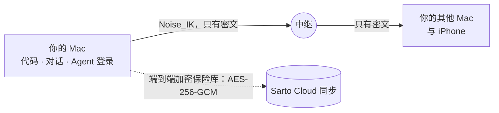

<div align="center">


<h1>Sarto</h1>

**原生、美观、私密的 macOS 智能体开发环境（ADE）——并行指挥 46 个编程 Agent，边 Coding 边挂机。**

_Sarto_ 在意大利语里是「裁缝」：用纯正 SwiftUI 与 Metal，把 Claude Code、Codex、Gemini CLI、Git Worktree、刘海灵动岛与像素挂机 RPG 裁剪缝合成一件合身的 **ADE** 工作台。

[](#为什么是-sarto-ade)
[](#生于-mac且精于审美)
[](#安装)
[](#支持的-agent)
[](#边-coding-边挂机内置-agent-rpg)
[](../../PRIVACY.zh-CN.md)
[](https://sarto.1o.ink/releases/latest)
[](../../LICENSE)

[下载](https://sarto.1o.ink/releases/latest) · [为什么是 ADE](#为什么是-sarto-ade) · [边 Coding 边挂机](#边-coding-边挂机内置-agent-rpg) · [支持的 Agent](#支持的-agent) · [常见问题](#常见问题) · [安全](../../SECURITY.zh-CN.md) · [隐私](../../PRIVACY.zh-CN.md) · [English](./README-E-recommended-hybrid.md)

</div>

> [!NOTE]
> Sarto 处于早期快速开发阶段：当前版本 v0.3.2，支持 Apple 芯片、macOS 15 及以上。

## 为什么是 Sarto ADE

IDE 为「手写单个文件」而生；纯终端标签页又难以兼顾多路 Diff 审阅、应用预览与五个 Agent 同时审批。**Sarto 是原生的智能体开发环境（ADE，Agentic Development Environment）**——专为并行指挥多个编程 Agent，并享受模型思考间隙而设计：

| 对比维度             | Electron 套壳 AI IDE  | 纯终端 CLI 命令行  | Sarto —— 原生 macOS ADE                                   |
| -------------------- | --------------------- | ------------------ | --------------------------------------------------------- |
| **运行底座**         | Chromium / Electron   | 仅纯文本终端       | **纯 Swift 6、SwiftUI、AppKit 与 Metal**（零第三方依赖）  |
| **Agent 与订阅**     | 绑定单一厂商/席位加价 | 每个标签页各跑一个 | **一个界面驱动 46 个 Agent**，100% 复用本机安装与自有订阅 |
| **并行与版本控制**   | 手动多开窗口          | 手动建 Worktree    | **内置 Git Worktree、中途换 Agent、统一 Diff 与文件回退** |
| **macOS 独门交互**   | 无                    | 无                 | **刘海凹肩灵动岛跨机审批 + 菜单栏液态额度面板**           |
| **等待长任务时**     | 盯着转圈发呆          | 刷滚动日志         | **内置像素风 Agent 挂机 RPG——边写代码边打穿 Todo 升级**   |
| **跨设备与代码隐私** | 含云端遥测            | 仅单机或手动配 SSH | **远程 Claude Code + 多 Mac 与 iPhone `Noise_IK` 加密**   |

## 亮点

<table>
<tr>
<td width="33%" valign="top">

**美观**<br/>
四套 Metal 光学主题与实时切换的配套 Dock 图标、克制的动效，以及从刘海里长出来的灵动岛。

</td>
<td width="33%" valign="top">

**原生 macOS ADE**<br/>
SwiftUI、AppKit 与 Metal 打造，零 Electron；菜单栏额度常驻、`⌘` 快捷键，感知低电量与发热。

</td>
<td width="33%" valign="top">

**46 个 Agent，一个界面**<br/>
Claude Code、Codex、Gemini CLI、Cursor、Copilot、Antigravity、OpenCode、Cline 等 46 个，复用自有账号。

</td>
</tr>
<tr>
<td valign="top">

**边 Coding 边挂机**<br/>
右侧栏内置像素协作 Todo 战斗与挂机 RPG：Agent 一边交付代码，一边刷装备、攒战力升级。_开发中。_

</td>
<td valign="top">

**远程 Claude Code**<br/>
让 Claude Code 的模型跑在你的另一台 Mac 上，文件、命令与权限留在眼前这台。

</td>
<td valign="top">

**博采众长**<br/>
汲取 Kettu、Cindy、Obsidian Prism 与 Code Island 之长，原生地缝合成一件私密的 ADE。

</td>
</tr>
</table>

## 所有 Agent，一个多智能体工作台

- **6 个原生驱动 + 40 个 ACP Agent**：为 **Claude Code**、**Codex**、**OpenCode**、**Pi**、**DeepSeek Harness** 与 **Cline** 提供专门的 SDK、Server 与 RPC 驱动（OpenCode 与 Cline 可回退到 ACP），另以 Agent Client Protocol 接入 40 个 Agent，包括 **Google Antigravity**、**Gemini CLI**、**Cursor**、**GitHub Copilot**、**Qwen Code** 与 **Kimi Code**。Sarto 自身不实现任何 Agent，驱动的是你自己的安装、账号与配置。
- **深度支持 Antigravity**：上下文明细、逐请求遥测、计划模式、子 Agent、插话、提问表单、插件与套餐额度。
- **Agent 生命周期管理**：检测前置条件，引导安装与更新，按 Agent 设置二进制路径与启动方式，以及 Claude Code、Codex、DeepSeek Harness 与 Antigravity 的默认权限模式。
- **会话中途换 Agent**：两轮之间把会话交给另一个 Agent，携带上下文，也可先做摘要。
- **带上你的历史**：导入你在 Claude Code、Codex、Pi 或任何可列出会话的 ACP Agent 中开始的会话。
- **额度一目了然**：读取各已登录 Agent 在厂商处的套餐额度与余额，并按 API 标价从本地记录统计 Token 与花费。

## 边 Coding 边挂机：内置 Agent RPG

> [!NOTE]
> 开发中：玩法、数值与美术仍在调整。

多 Agent 编程天然伴随着模型推理、跑单测与执行计划的等待间隙。Sarto 在可折叠的右侧栏里，把后台任务变成了零打扰的 **Agent 挂机 RPG**：

- **像素协作 Todo 战斗**：当会话带有计划时，Sarto 与你的 Agent 会在像素战斗舞台组队出击——真实编码回合持续发射弹幕与自动技能，每完成一步计划就打出一记终结伤害。
- **每个 Agent 独立角色卡**：通过真实编码而非枯燥点击，养成每个 Agent 的段位头衔、战力评分（`PWR`）、秒伤（`DPS`）、武器装备、勋章与指挥官羁绊等级。
- **安静省电，不抢心流**：支持从 **街机（Arcade）** 战斗（武器、技能与伤害跳字）平滑降级到 **安静**、**静止** 或 **关闭**，并在静止窗口、低电量模式与发热时自动降帧。
- **挂机也私密**：游戏进度仅依赖脱敏的耗时与步骤事实——源代码、Prompt 与文件路径永不离开你的 Mac。

## 围绕对话的工作台

- **输入框**：双层悬浮输入框，含 Agent 与模型选择、置顶模型、按模型真实能力的思考深度、权限模式、项目与 Git Worktree 选择、`@` 引用文件/目录/会话、`/` 命令、图片与附件、`↑`/`↓` 历史输入，以及上下文、提示缓存与输出速度的实时浮窗。
- **流程控制**：运行中可排队后续消息或插话引导。在 Agent 支持时，可编辑已发消息，让对话连同文件一起回退，反悔了还能放回；也可从任意回复分叉新会话；提示缓存将失效时会提前提醒。
- **内联评论**：对回复中的段落写评论，随下一条消息一起发送。
- **会话看板与子 Agent**：后台命令、监控与子 Agent 的实时进度，内联子 Agent 卡片与会话跳转。
- **随处可找**：`⌘K` 搜索所有已连接 Mac 上的全部会话，`⌘F` 会话内查找，大纲浮窗、时间轴与会话级阅读位置让长对话也好读；任意会话可导出为 Markdown。
- **Git**：相对 `HEAD` 的 Diff 与按文件选择提交、分支与 Worktree 隔离会话、AI 起草提交说明与 Pull Request，以及处理冲突、失败检查、Review、发布与在 GitHub 合并的下一步面板。
- **文件与终端**：项目文件树与编辑器（检测保存冲突、恢复草稿），以及可从 Agent 手中接管再交还的 PTY 终端；终端要求输入密码时，Sarto 会暂停 Agent 输入。
- **预览**：Agent 可检查、可操作（你也可接管）的内置浏览器、iOS 模拟器，以及 Android 模拟器与真机，并排预览。

## 生于 Mac，且精于审美

- **灵动岛**：凹肩造型，贴合 MacBook 刘海或任意显示器顶部，可在显示器分布图上选一块或多块屏幕。实时显示计划进度，可在任意一台 Mac 上直接处理权限、提问与计划审批，并有会话堆叠、用量页与九点活动指示。
- **菜单栏用量面板**：液态额度柱、套餐圆环、实时会话横幅、今日模型排行，以及跨 Agent、跨 Mac 的 7 / 30 / 90 天堆叠用量图。关闭窗口后 Sarto 与 Agent 仍在菜单栏后台运行；`⌘Q` 需按两次才会关闭窗口。
- **Prism 视觉系统**：四套 Metal 绘制的光学主题（`Obsidian Dark`、`Warm Charcoal`、`Daylight Crystal`、`Warm Alabaster`）与实时切换的配套 Dock 图标，HSB 色轮、可展开工具时间轴、长代码折叠、GFM/SVG/Mermaid/数学公式渲染，以及完整中英双语界面。
- **签名自动更新与独立 daemon**：Ed25519 + Apple 代码签名增量更新不断会话；支持无界面 `sarto` CLI。

## 远程 Claude Code、多台 Mac 与 iPhone

- **远程 Claude Code**：在这台 Mac 开启会话，让 Claude Code 的**模型跑在账号下另一台已登录的 Mac 上**，而项目文件、Shell 命令、权限与 Sarto 工具留在当前本机，支持主机并发限制与空闲自动回收。
- **所有 Mac 一个侧栏**：实时连接状态、跨 Mac 搜索、灵动岛审批，以及远程文件、Git 与终端（未在该机开启前默认关闭），通过 8 位 `XXXX-XXXX` 核对码或 128-bit 恢复密钥安全配对。
- **Sarto for iPhone**：原生 iOS 配套应用，适配 iPhone Duo 折叠屏，支持端到端加密推送与随时随地审批（_Beta 已完成，即将上架 App Store，暂未包含在本仓库_）。

## 隐私为本，人人可验证

Sarto 驱动的 Agent 会读代码、跑命令，因此**你无需把工作托付给任何服务器**：

- **工作只留在你的 Mac 上。** 源代码、项目文件、对话历史与各 Agent 登录态永不进入 Sarto Cloud；零遥测、零统计、账号可选。
- **凡是离开本机的，都端到端加密。** 设备互联采用 `Noise_IK_25519_AESGCM_SHA256`，经由只转发填充密文的中继；设置、MCP 密钥、Skill、主题、记忆与用量由设备独占的 256-bit 密钥同步（`HKDF-SHA256`、`AES-256-GCM`）；推送按手机密钥独立封装。
- **开源到协议层，构建可追溯。** 应用与 daemon 采用 AGPL-3.0，通信协议写在 Apache-2.0 的 [`packages/sarto-wire`](../../packages/sarto-wire/PROTOCOL.md) 中，发布版由 [GitHub Actions](../../.github/workflows/release-mac.yml) 构建并附 SLSA 溯源证明与 `SHA256SUMS.txt`。详见 [SECURITY.zh-CN.md](../../SECURITY.zh-CN.md) 与 [PRIVACY.zh-CN.md](../../PRIVACY.zh-CN.md)。



## 扩展、记忆与裁缝渊源

- **MCP Hub、插件与共享记忆**：钥匙串加密的 MCP 服务器（支持 OAuth 与内联表单）、Claude Code / Codex / Antigravity 插件管理、Sarto 原生 MCP 工具，以及跨 Agent 共享的全局与项目记忆。
- **博采众长**：原生地裁剪融合了 [Kettu](https://github.com/KettuAI/Kettu)（去 Electron 化的 daemon 架构）、[Cindy](https://github.com/makecindy/cindy)（菜单栏用量面板与对话时间轴）、[Obsidian Prism](https://github.com/RMvdesi/obsidian-prism)（调色板与动效）与 [Code Island](https://github.com/wxtsky/CodeIsland)（灵动岛轮廓）。完整声明见 [THIRD_PARTY_NOTICES.md](../../THIRD_PARTY_NOTICES.md)。

## 安装

### Mac 应用

从 [`sarto.1o.ink/releases/latest`](https://sarto.1o.ink/releases/latest) 下载 `Sarto-<版本>-arm64.dmg` 并拖入「应用程序」（需 Apple 芯片与 macOS 15+，内置 daemon 与 Node.js）。

### 独立 daemon

```sh
curl -fsSL https://sarto.1o.ink/releases/latest/download/install.sh | sh
```

安装至 `~/.local/share/sarto`，链接 `~/.local/bin/sarto` 并注册 launchd 服务（传 `sh -s -- --no-service` 可跳过），随后运行 `sarto login`。

### 从源码构建

需要 Apple 芯片与 macOS 15+、Xcode 16+、Node.js 22.13+ 与 pnpm 10（详见 [CONTRIBUTING.md](../../CONTRIBUTING.md)）：

```sh
pnpm install
pnpm build:daemon
open apps/apple/Sarto.xcodeproj
```

## 支持的 Agent

<details>
<summary><b>全部 46 个 Agent</b></summary>

|                                                                     |                                                                                     |                                                          |                                                                             |
| ------------------------------------------------------------------- | ----------------------------------------------------------------------------------- | -------------------------------------------------------- | --------------------------------------------------------------------------- |
| [Claude Code](https://github.com/anthropics/claude-code)            | [Codex](https://github.com/openai/codex)                                            | [OpenCode](https://opencode.ai)                          | [Pi](https://pi.dev)                                                        |
| [DeepSeek Harness](https://github.com/deepseek-ai/deepseek-harness) | [Cline](https://cline.bot/cli)                                                      | [Google Antigravity](https://antigravity.google)         | [Gemini CLI](https://github.com/google-gemini/gemini-cli)                   |
| [Cursor](https://cursor.com/docs/cli/acp)                           | [GitHub Copilot](https://github.com/github/copilot-cli)                             | [Qwen Code](https://github.com/QwenLM/qwen-code)         | [Kimi Code](https://github.com/MoonshotAI/kimi-code)                        |
| [Grok](https://x.ai/cli)                                            | [Amp](https://ampcode.com)                                                          | [goose](https://block.github.io/goose/)                  | [Kilo Code](https://kilo.ai)                                                |
| [Factory Droid](https://factory.ai/product/cli)                     | [OMP (Oh My Pi)](https://omp.sh)                                                    | [Hermes Agent](https://hermes-agent.nousresearch.com)    | [Devin](https://docs.devin.ai/cli)                                          |
| [Mistral Vibe](https://github.com/mistralai/mistral-vibe)           | [Junie](https://junie.jetbrains.com)                                                | [Auggie CLI](https://github.com/augmentcode/auggie)      | [VT Code](https://github.com/vinhnx/VTCode)                                 |
| [Qoder CLI](https://qoder.com)                                      | [Qoder CN](https://qoder.cn)                                                        | [Codebuddy Code](https://www.codebuddy.cn/cli/)          | [DeepAgents](https://docs.langchain.com/oss/javascript/deepagents/overview) |
| [DimCode](https://dimagent.cn/)                                     | [Dirac](https://dirac.run)                                                          | [GLM Agent](https://github.com/stefandevo/glm-acp-agent) | [Nova](https://www.compassap.ai/portfolio/nova.html)                        |
| [siGit Code](https://github.com/getsigit/sigit)                     | [Agoragentic](https://agoragentic.com)                                              | [Autohand Code](https://www.autohand.ai/cli/)            | [Muse Code](https://dev.meta.ai)                                            |
| [CodeWhale](https://codewhale.net)                                  | [Bob](https://bob.ibm.com)                                                          | [MiniMax Code](https://agent.minimax.io)                 | [Harn](https://harnlang.com)                                                |
| [Kimchi](https://kimchi.dev)                                        | [Cortex Code](https://docs.snowflake.com/en/user-guide/cortex-code/cortex-code-cli) | [Corust Agent](https://corust.ai)                        | [crow-cli](https://github.com/crow-cli/crow-cli)                            |
| [Poolside](https://poolside.ai)                                     | [Stakpak](https://stakpak.dev)                                                      |                                                          |                                                                             |

</details>

## 常见问题

<details>
<summary><b>ADE（智能体开发环境）和传统 AI IDE 有什么不同？</b></summary>

IDE 围绕「逐文件手写代码」设计；**ADE（Agentic Development Environment）** 围绕「同时编排多个自主编程 Agent」设计——把 Git Worktree 并行、计划/权限审批、统一 Diff 审阅、PTY 终端、实时预览与套餐额度整合在一个原生应用里。

</details>

<details>
<summary><b>可以直接用我自己的 Claude、OpenAI 或 Gemini 订阅吗？</b></summary>

可以。Sarto 直接驱动你本机安装的 CLI、官方订阅与自有 API Key，零中间加价，Sarto 账号也是可选的。

</details>

<details>
<summary><b>内置挂机 RPG 会把代码或 Prompt 上传到服务器吗？</b></summary>

绝不会。游戏结算只使用脱敏的耗时与步骤计数——源代码、Prompt 与文件路径永不离开你的 Mac。

</details>

## 搜索标签

`ade` · `agentic-development-environment` · `agent-development-environment` · `智能体开发环境` · `Agent 开发环境` · `原生 macOS` · `SwiftUI` · `Metal` · `多 Agent 协同` · `多智能体并行开发` · `边 coding 边挂机` · `边写代码边挂机` · `编程挂机游戏` · `内置挂机 RPG` · `Vibe Coding` · `Claude Code 客户端` · `Claude Code GUI` · `Codex 桌面端` · `Gemini CLI` · `Cursor` · `GitHub Copilot` · `OpenCode` · `Cline` · `Antigravity` · `ACP 协议` · `MCP` · `Git Worktree` · `Mac 灵动岛` · `AI 用量监控` · `端到端加密`

## 反馈与许可证

欢迎用任何语言提交 [Issue](https://github.com/Rladmsrl/Sarto/issues/new/choose)。安全问题请按 [SECURITY.zh-CN.md](../../SECURITY.zh-CN.md) 私密上报。

[AGPL-3.0](../../LICENSE)，[`packages/sarto-wire`](../../packages/sarto-wire) 除外（采用 Apache-2.0）。第三方许可见 [THIRD_PARTY_NOTICES.md](../../THIRD_PARTY_NOTICES.md)。Sarto 是独立项目，与 Anthropic、OpenAI、Google、Apple 及任何 Agent 开发方均无关联，也未获其背书。
